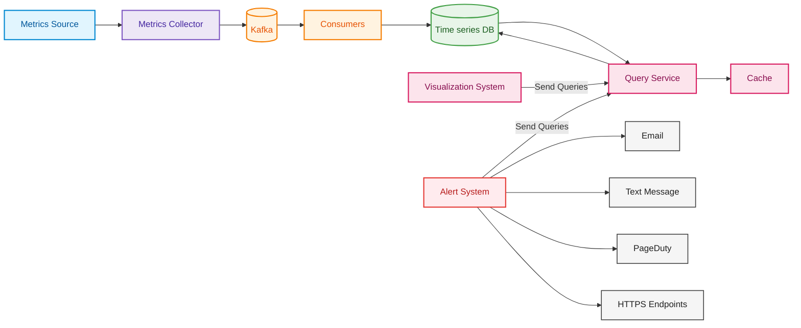
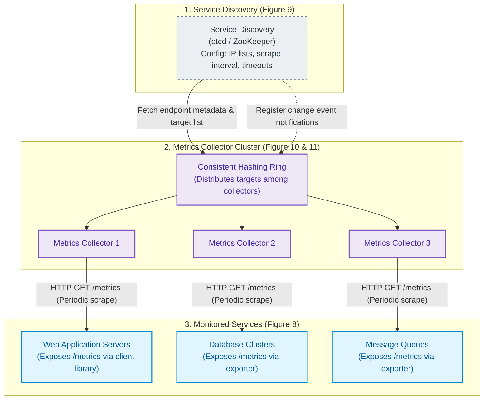
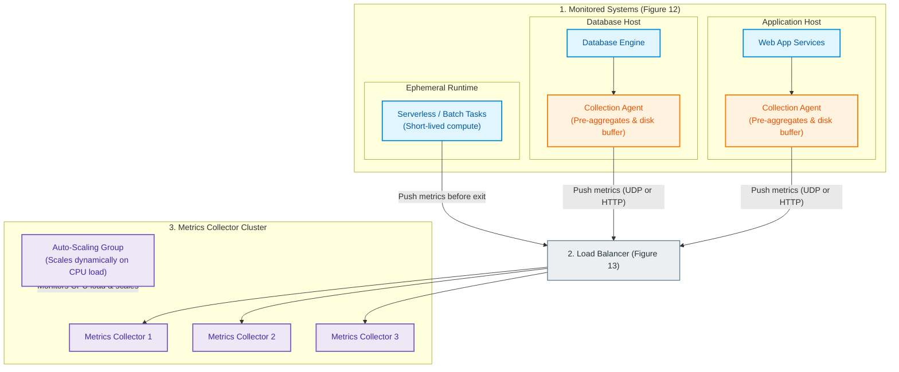

# Metrics Monitoring and Alerting System: Figure 22 Final Design Architecture

> **Reference Source**: *System Design Interview – An Insider's Guide: Volume 2*, Chapter 5: *Metrics Monitoring and Alerting System*  
> **Source PDF**: `Metric/Watchdog/Metrics-Monitoring-System-Design-2/System design-2-chapter 5.pdf` (Page 30, Figure 22)

---

## 1. End-to-End System Architecture (Figure 22)



---

## 2. Metrics Collection Subsystem: Pull Model vs. Push Model

### 2.1 Pull Model Architecture (Figures 8, 9, 10, 11)
In the pull model (exemplified by **Prometheus**), the metrics collector actively queries endpoints exposed by monitored services.



#### Pull Model Mechanics (Figure 10 & 11):
1. **Metadata Retrieval**: The metrics collector queries **Service Discovery** (`etcd` or `ZooKeeper`) for configuration rules (scraping intervals, target IP addresses, timeout parameters, and retry policies).
2. **Periodic Scraping**: The collector sends HTTP GET requests to a standardized endpoint (e.g., `/metrics`) exposed by the target service via a metrics client library.
3. **Change Event Notifications**: Collectors either register event listeners with Service Discovery or poll periodically to learn about newly spawned or decommissioned hosts.
4. **Consistent Hashing Coordination**: To scale beyond thousands of servers and avoid duplicate scraping, collectors join a **Consistent Hashing Ring**. Each server's unique name/IP maps to a position on the ring, assigning it exclusively to a single collector node (e.g., Collector 2 is assigned Server 1 and Server 5).

---

### 2.2 Push Model Architecture (Figures 12, 13)
In the push model (exemplified by **Amazon CloudWatch** and **Graphite**), monitored servers take the initiative to transmit their operational metrics outward to collectors.



#### Push Model Mechanics (Figure 12 & 13):
1. **Local Collection Agent**: A daemon installed on monitored hosts collects runtime counters and utilization readings.
2. **Local Pre-Aggregation & Disk Buffering**: Agents aggregate simple counters locally (e.g., 1-minute sums) to reduce network bandwidth. If collectors reject pushes due to high traffic, the agent buffers data locally on disk to retry later.
3. **Load Balancer Routing**: Monitored servers and ephemeral serverless jobs push metrics over UDP or HTTP to a dedicated **Load Balancer**.
4. **Auto-Scaling Collector Tier**: The Load Balancer evenly distributes write traffic across a cluster of collector nodes that dynamically scales up or down based on average CPU utilization.

---

### 2.3 Pull vs. Push Trade-Off Matrix (Table 3 from Chapter 5)

| Dimension | Pull Model (e.g., Prometheus) | Push Model (e.g., CloudWatch, Graphite) | Winner / Operational Note |
| :--- | :--- | :--- | :--- |
| **Easy Debugging** | The `/metrics` endpoint can be viewed and verified anytime directly on a laptop using `curl`. | Requires a listening collector endpoint and network ingress to receive pushes. | **Pull wins** |
| **Health Check** | If an application host does not respond to a scrape, the collector immediately knows the server is down. | If the collector receives no metrics, it is difficult to distinguish host failure from network glitches. | **Pull wins** |
| **Short-Lived Jobs** | Ephemeral batch or serverless jobs may terminate before the next scheduled scrape cycle. | Short-lived tasks push their metrics before exiting (or use push gateways in pull setups). | **Push wins** |
| **Firewall & Multi-DC** | Requires collectors to have inbound network reachability to all endpoints across subnets/datacenters. | Monitored nodes initiate outbound connections to the Load Balancer, easily traversing firewalls. | **Push wins** |
| **Performance** | Typically uses TCP connection handshakes for reliable polling over HTTP. | Often uses lightweight UDP for lower-latency, fire-and-forget metrics transmission. | **Push wins** (lower transport overhead) |
| **Data Authenticity** | Collectors only pull from hosts explicitly declared in configuration and service discovery. | Any client can push metrics to collectors unless strict IP whitelisting or authentication is enforced. | **Pull wins** |

---

## 3. In-Depth Step-by-Step Pipeline Description

### Step 1: Metrics Source → Metrics Collector
The entry point of operational observability where raw performance and resource utilization numbers are generated and collected.

* **Metrics Sources**:
  * Infrastructure and software layers including application servers, database clusters, message brokers, caching nodes, and ephemeral serverless jobs.
  * Primary metric categories: Request Counts (traffic load), Memory Usage (host/container resource consumption), CPU Load, and Message Count in Message Queues (backlog depths).
* **Collection Models (Pull vs. Push)**:
  * **Pull Model (e.g., Prometheus)**:
    * The **Metrics Collector Cluster** periodically polls `/metrics` HTTP endpoints exposed by target servers.
    * **Service Discovery**: Uses distributed registries like `etcd` or `ZooKeeper` to dynamically track running instances, port numbers, and endpoint availability.
    * **Consistent Hashing**: A consistent hashing ring coordinates collector nodes so that each collector is assigned a defined subset of monitored servers, ensuring balanced scraping distribution and seamless failover.
    * *Advantages*: Simple debugging via standard `curl`, instant health detection (unreachable endpoint signifies host failure).
  * **Push Model (e.g., CloudWatch, Graphite)**:
    * A lightweight **Collection Agent** runs locally on each host, pre-aggregates counters (e.g., 1-minute sums), and pushes payloads upstream.
    * A **Load Balancer** sits in front of the collector cluster to distribute incoming network traffic.
    * *Advantages*: Ideal for ephemeral, short-lived jobs (serverless/batch runs) that finish before a pull cycle occurs; easily penetrates firewalls without opening incoming listener ports on monitored hosts.

---

### Step 2: Metrics Collector → Kafka (Transmission Queue)
Buffers high-volume ingestion streams and decouples the collection tier from the storage tier.

* **Why an Intermediate Message Queue is Essential**:
  * Collector nodes receive tens of millions of metric data points per day. Writing directly to database clusters during peak load creates severe risk of write degradation or data loss if the database becomes unavailable.
  * **Apache Kafka** serves as a fault-tolerant, append-only log buffer. Incoming measurements accumulate safely in Kafka even during database outages or storage maintenance.
* **Partitioning & Scaling Strategy**:
  * **Throughput Sizing**: Topic partition counts are scaled to match expected writes per second and consumer worker concurrency.
  * **Partitioning by Metric Name**: Routing identical metric names (e.g., `cpu.load`) to dedicated partitions enables downstream consumers to group and aggregate metrics sequentially.
  * **Partitioning by Labels/Tags**: Applying tags (e.g., `region: us-west`) ensures co-location of related time series within partitions.
  * **Priority Tiering**: Mission-critical operational metrics (e.g., payment gateway errors) route through high-priority topics to guarantee low-latency processing before lower-priority background stats.
* **Architectural Alternative**:
  * Ultra-high-availability in-memory time-series databases like Facebook's **Gorilla**, which achieve comparable write resilience without intermediate queues by relying on aggressive double-delta timestamp and XOR float compression directly in RAM.

---

### Step 3: Kafka → Consumers (Stream Processing Layer)
Continuous stream consumption, validation, and real-time processing before persistent write operations.

* **Consumer Mechanics**:
  * Stream processing engines such as **Apache Flink**, **Apache Storm**, or **Apache Spark**, or custom horizontally scalable consumer worker groups.
* **Core Responsibilities**:
  * Pull real-time metric streams from assigned Kafka partitions.
  * Execute real-time tumbling and sliding window calculations (e.g., 5-minute rolling averages, per-second rate functions).
  * Validate and transform payloads into standardized time-series structures.
  * Buffer and batch records for high-throughput block writes to the database.

---

### Step 4: Consumers → Time series DB (Storage Layer)
Specialized persistent storage optimized for sequential, high-frequency numerical time-series writes.

* **Time-Series Data Model**:
  * Each record is structured as:
    ```
    metric_name {tag_key=tag_value, ...} value timestamp
    ```
    *Example*: `cpu.load{host="server-01", region="us-east"} 1.25 1610087371`
* **Storage Access Patterns**:
  * **Write-Heavy**: Continuous append-only writes; updates and deletes are virtually non-existent.
  * **Spiky Reads**: Dashboards and alert evaluation jobs query recently ingested windows in bursts.
  * **Temporal Access Recency**: Research shows ≥ 85% of all queries target data written within the preceding 26 hours.
* **Why Specialized TSDB over Traditional RDBMS**:
  * Relational databases face severe index lock contention and costly random disk I/O under constant append streams.
  * TSDBs (e.g., **InfluxDB**, **Prometheus**) use columnar storage engines, memory buffers (LSM-tree/time-structured merge), and specialized compression:
    * **Timestamp Compression (Delta-of-Deltas)**: Timestamps spaced 10 seconds apart require only 4 bits instead of 32 bits.
    * **Value Compression**: XOR floating-point encoding drastically reduces numerical disk footprints.
* **Downsampling & Data Retention Strategy**:
  * To balance retention cost with query utility over a 1-year retention lifespan:
    * **Raw Resolution (e.g., 10s intervals)**: Retained for 7 days.
    * **Downsampled to 1-Minute Resolution**: Retained for 30 days.
    * **Downsampled to 1-Hour Resolution**: Retained for 1 year.

---

### Step 5: Time series DB ↔ Query Service → Cache
The data retrieval abstraction layer shielding the database from heavy analytical queries.

* **Query Service (Stateless API Layer)**:
  * A dedicated cluster of stateless API servers acting as an abstraction wrapper over the storage tier.
  * Decouples upstream visualization and alerting clients from the underlying database engine, allowing backend migrations without breaking changes.
  * Translates custom time-series query languages (**PromQL**, **Flux/InfluxQL**) optimized for time windowing and rate evaluations that are difficult and slow in standard SQL.
* **Cache Layer**:
  * An in-memory cache sitting alongside or below the Query Service.
  * Caches results of frequent, resource-heavy queries (e.g., standard organizational dashboards or broad historical time ranges), dramatically reducing compute load on the TSDB.
* **Trade-Off Context**:
  * In smaller systems, modern visualization tools (like Grafana) can interface directly with TSDBs using native plugins, which may make a custom Query Service and separate cache layer redundant unless scaling at enterprise volume.

---

### Step 6: Visualization System → Send Queries → Query Service
Operational dashboards providing live visibility across infrastructure components.

* **Role & Functionality**:
  * Visualization platforms (such as **Grafana**) query the TSDB through the Query Service.
  * Render real-time charts: server request rates, CPU/memory saturation, network I/O, and queue backlog trends.
* **Build vs. Buy Decision**:
  * Building a custom charting and dashboard engine requires substantial frontend engineering effort. Off-the-shelf tools like Grafana are industry standard, cost-effective, and provide native multi-TSDB support.

---

### Step 7: Alert System → Send Queries → Query Service
Automated rule evaluation and notification engine monitoring system health.

* **Execution Cycle**:
  1. **Config Loading**: Alert rules defined in YAML/JSON (e.g., `alert: instance_down, expr: up == 0, for: 5m`) are loaded into cache servers.
  2. **Scheduled Querying**: The Alert Manager queries the Query Service at fixed intervals (e.g., every 60 seconds) to evaluate threshold conditions.
  3. **Filter, Dedupe, and Merge**: Prevents alert fatigue by merging cascading alerts from the same instance or cluster into a single consolidated event.
  4. **Alert Store (e.g., Cassandra / Key-Value Store)**: Maintains state transitions (`inactive`, `pending`, `firing`, `resolved`) to enforce at-least-once delivery guarantees.
  5. **Notification Queueing**: Formatted alert events are placed into notification topics.

---

### Step 8: Alert System → Alert Destinations
Dispatching targeted, actionable notifications across channels based on severity level.

* **Notification Targets**:
  * **Email**: Low-severity, non-urgent summaries and weekly infrastructure status reports.
  * **Text Message (SMS)**: Medium-to-high urgency notifications sent directly to on-call personnel.
  * **PageDuty**: High-priority / critical production incidents requiring automated escalation policies and active paging.
  * **HTTPS Endpoints**: Webhooks communicating with external automation platforms to trigger remediation scripts (e.g., auto-scaling node pools, rolling back deployments, or restarting failed containers).

---

## 4. Summary of Key Architectural Decisions & Trade-Offs

| Decision Area | Chosen Approach in Figure 22 | Key Trade-Off & Operational Benefit |
| :--- | :--- | :--- |
| **Collection Model** | Hybrid (Pull with Service Discovery & Push with Load Balancers) | Pull provides simplicity and instant health status; Push accommodates serverless/ephemeral tasks. |
| **Ingestion Decoupling** | Apache Kafka | Decouples collectors from DB write latency; prevents metric data loss during storage outages. |
| **Storage Engine** | Dedicated Time-Series DB (TSDB) | Handles write-heavy append workloads; provides 80–90% storage savings via delta and XOR compression. |
| **Query Abstraction** | Stateless Query Service + In-Memory Cache | Isolates clients from DB topology; prevents expensive dashboard queries from overloading the TSDB. |
| **Alert Management** | State-managed Alert Store + Merging/Deduping | Eliminates duplicate notifications; guarantees at-least-once notification dispatch. |
