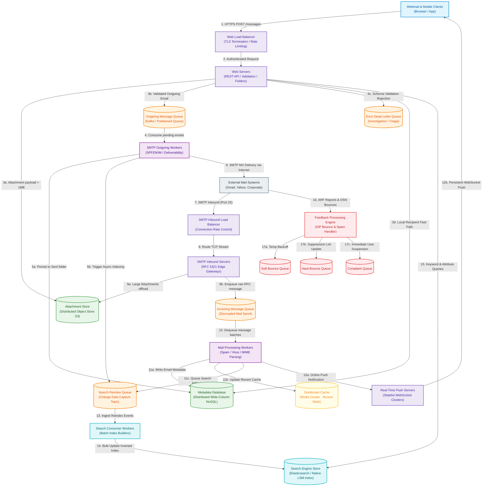
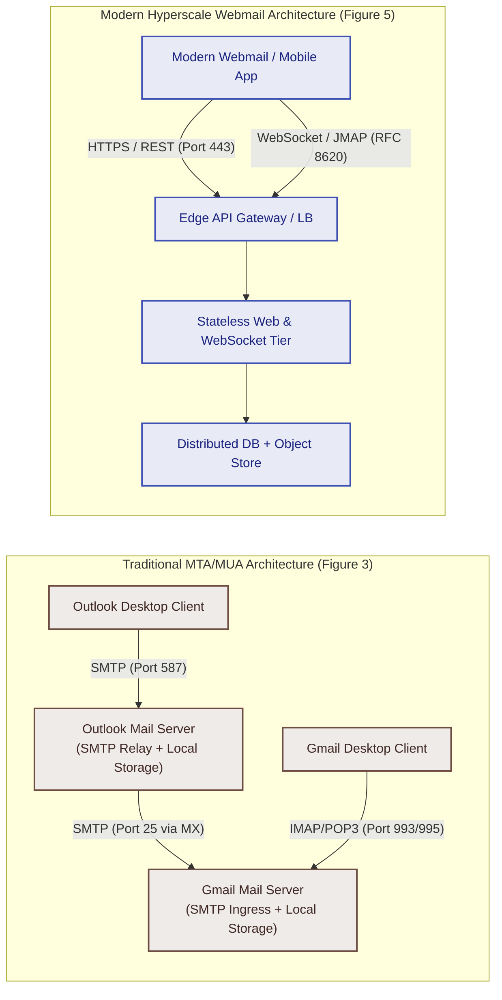
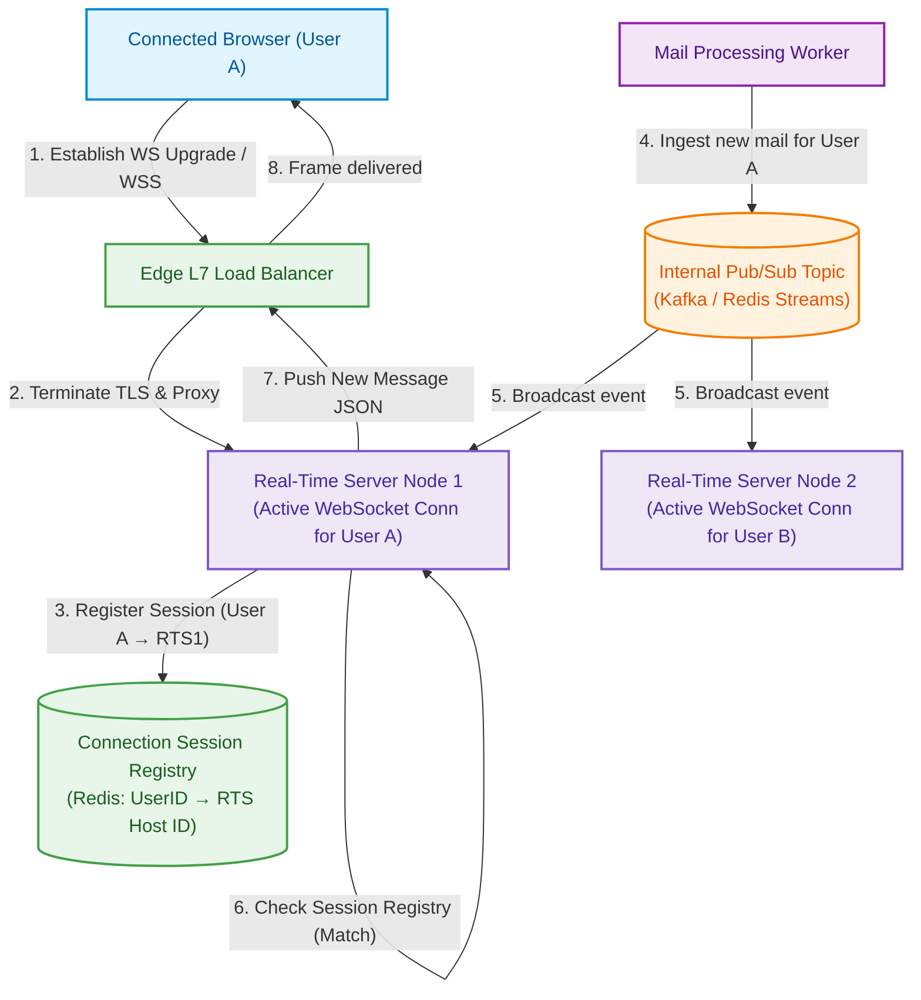
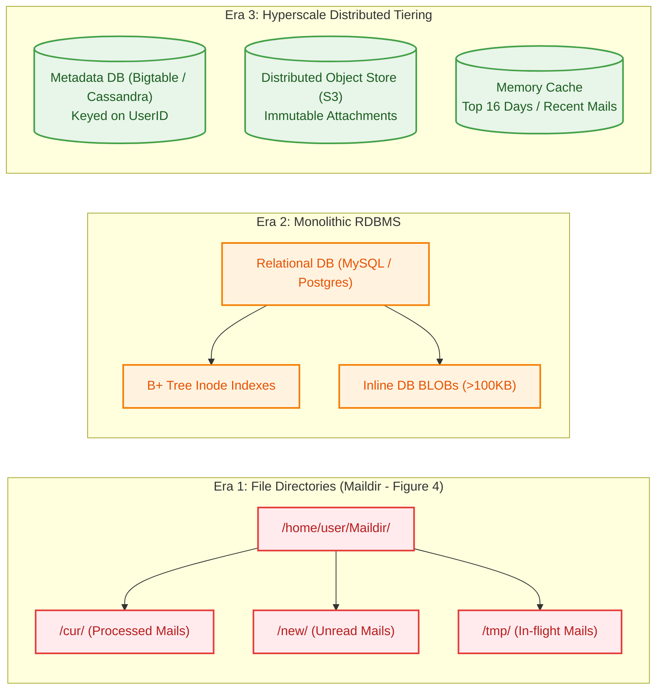
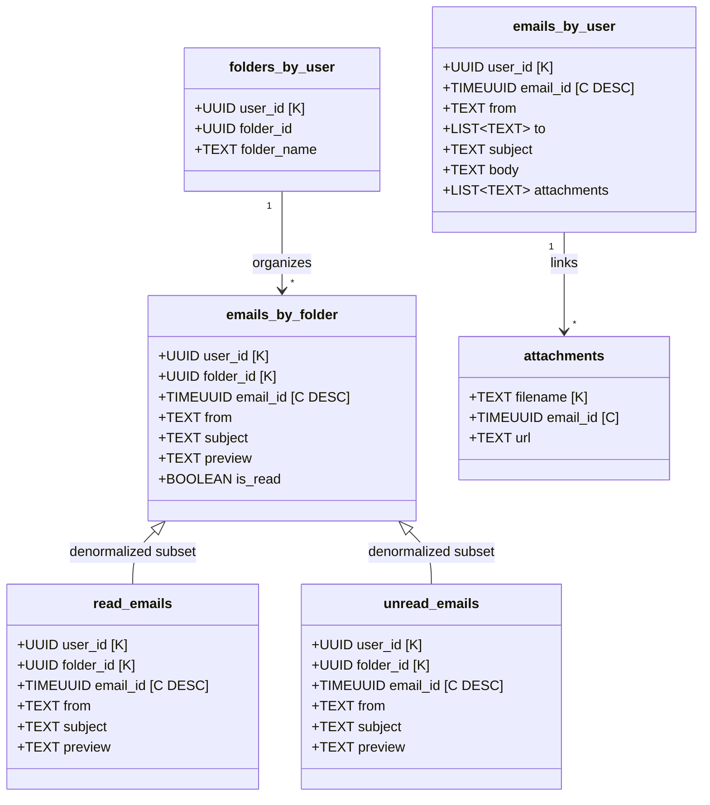
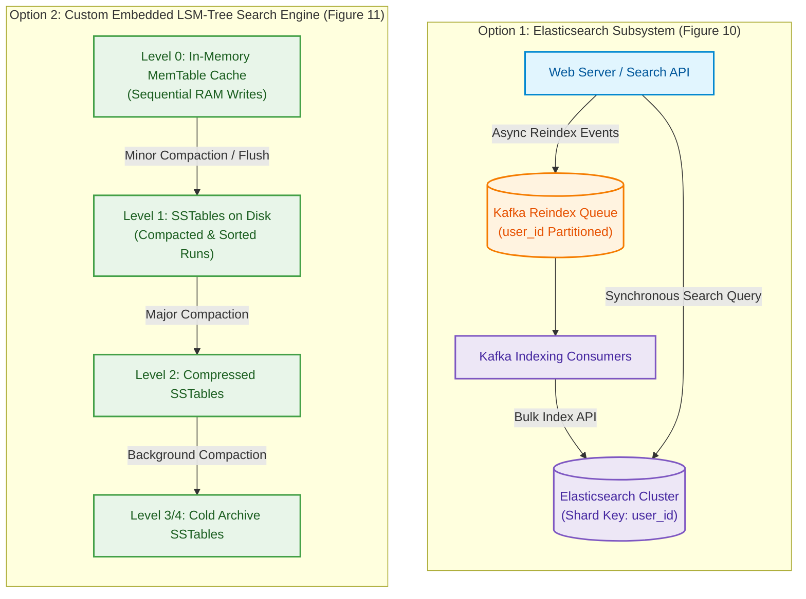
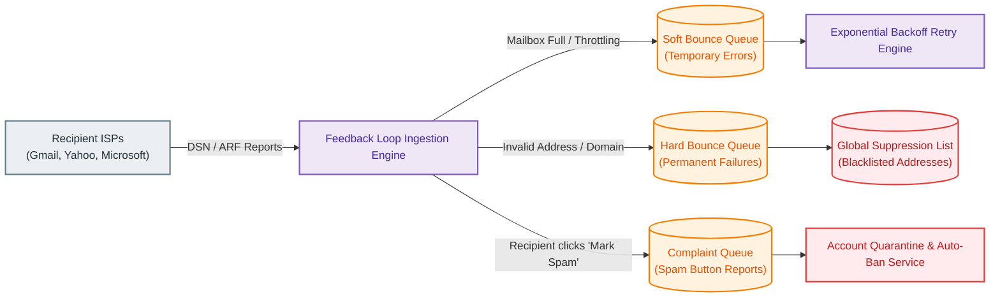

# Distributed Email Service: Figure 5 Final Design Architecture

> **Reference Source**: *System Design Interview – An Insider's Guide: Volume 2*, Chapter 8: *Distributed Email Service*  
> **Source Material**: `Notification System/Distributed Email Service/System design-2-chapter 8.pdf` (Figures 5, 6, 7, 8, 10, 11, 12)  
> **Text Cache**: `Notification System/Distributed Email Service/chapter-8-raw-text.txt`

---

## 1. End-to-End System Architecture (Figure 5, 6 & 7 Unified)

The Distributed Email Service is designed to handle global-scale consumer and enterprise messaging, modeled after hyperscale systems such as Google Gmail and Microsoft Outlook. The architecture supports **1 billion active users**, an outbound ingestion rate of **100,000 sending QPS** ($10^9 \times 10 / 10^5$), an inbound delivery rate of **400,000 receiving QPS** ($10^9 \times 40 / 10^5$), annual metadata volume of **730 PB**, and annual attachment volume of **1,460 PB**.

To maintain high availability ($99.99\%$), strict zero data loss, low tail latency, and resilient ISP reputation, the system decouples synchronous edge ingress from asynchronous mail processing via distributed message queues, partitions mailbox state strictly by `user_id`, offloads large attachments to distributed object stores, denormalizes folder indices, and leverages asynchronous change-data-capture pipelines for full-text search indexing.



---

## 2. Key Subsystem Deep Dives & Architectural Variants

### 2.1 Email Transport Protocols: Legacy vs. Modern Webmail Standards

Traditional email transport relies on a tri-protocol suite established in early RFCs: **SMTP** (RFC 821 / RFC 5321) for store-and-forward relaying between mail transfer agents (MTAs), and **POP3** (RFC 1939) or **IMAP4rev1** (RFC 3501) for mail delivery to desktop clients.



#### Protocol Operational Mechanics:
1. **POP3 (Post Office Protocol 3)**: Downloads the entire message payload (including attachments) from the server to the single requesting machine and deletes the remote copy. 
   - *Limitation*: Multi-device synchronization is fundamentally impossible; device loss causes complete data loss.
2. **IMAP (Internet Message Access Protocol)**: Retains messages on the central server and downloads only message headers until the user clicks an individual message. Flags (`\Seen`, `\Draft`, `\Flagged`) are synchronized bidirectionally.
   - *Limitation*: High network round-trip overhead; stateful protocol with expensive connection handling; poor mobile battery life due to polling or long-lived TCP keep-alives (`IMAP IDLE`).
3. **HTTPS / RESTful APIs**: Web browsers and modern mobile clients speak standard HTTPS (e.g., Microsoft ActiveSync over HTTPS, or Google Gmail REST API). Payloads are JSON-formatted, highly compressed, stateless, and naturally traverse enterprise firewalls.
4. **JMAP (JSON Meta Application Protocol - RFC 8620 / RFC 8621)**: Designed as an efficient, modern replacement for IMAP. Executes batched, transactional data synchronization over HTTPS and WebSocket connections, drastically cutting mobile data consumption and latency.

#### Protocol Architectural Comparison Matrix

| Protocol Dimension | POP3 (RFC 1939) | IMAP4 (RFC 3501) | HTTPS / REST API | JMAP (RFC 8620) |
| :--- | :--- | :--- | :--- | :--- |
| **Server Persistence** | Remote copies deleted upon download. | Persistent on server. | Persistent on distributed storage. | Persistent on distributed storage. |
| **Multi-Device Sync** | Unsupported (single device only). | Supported (slow flag sync). | Supported (stateless sync). | Native, transactional batch sync. |
| **Bandwidth Efficiency** | Very Low (must fetch full attachments). | Moderate (fetches headers first). | High (paginated, partial JSON). | Ultra-High (delta sync & batched calls). |
| **Real-Time Push** | None (requires continuous polling). | `IMAP IDLE` (stateful TCP drain). | WebSocket / Long-Polling fallback. | Native WebSocket subprotocol. |
| **Mobile Optimization** | Incompatible with modern multi-device. | High battery & radio drain. | High efficiency; push notifications. | Optimized for intermittent connections. |
| **Firewall Traversal** | Blocked on enterprise networks. | Frequently blocked on ports 143/993. | Traverses standard port 443. | Traverses standard port 443. |
| **Winner** | **Obsolete** | **Legacy Clients Only** | **Standard Webmail** | **Recommended Future Standard** |

---

### 2.2 Client Ingestion & Real-Time Push Subsystem

When incoming mail arrives, notifying the active web client immediately requires a low-latency bidirectional channel. The system implements a tiered connection hierarchy pairing **WebSockets** with an HTTP **Long-Polling** fallback.



#### Push Protocol Trade-Off Matrix

| Dimension / Metric | WebSocket (Preferred) | HTTP Long-Polling (Fallback) | Server-Sent Events (SSE) |
| :--- | :--- | :--- | :--- |
| **Directionality** | Full-duplex (client & server send frames). | Half-duplex (server holds open GET request). | Half-duplex (server-to-client stream only). |
| **Header Overhead** | Minimal (2–10 byte frame headers). | High (HTTP headers resent on every poll cycle). | Low (event stream framing overhead). |
| **Connection State** | Stateful persistent TCP socket. | Quasi-stateless; re-established per cycle. | Stateful persistent HTTP socket. |
| **Firewall / Proxy Friction** | Occasional corporate proxy interference. | Traverses all corporate HTTP proxies. | Generally good, but some middleboxes buffer. |
| **Client Interaction** | Direct read acknowledgments & draft sync. | Requires separate POST request for upstream. | Requires separate POST request for upstream. |
| **Winner & Rule** | **Primary Choice for Modern Browsers** | **Mandatory Fallback for Restricted Networks** | **Alternative for strictly downstream feeds** |

> [!IMPORTANT]
> **Real-Time Push Scalability Rule**:
> Stateful WebSocket servers require a distributed **Connection Session Registry** (backed by Redis or an in-memory cluster) that maps each connected `user_id` to its active `server_node_id`. If a user is not present in the registry, the mail processing worker skips push notification, leaving the email in persistent storage for the user to query upon their next login.

---

### 2.3 Storage Architecture Evolution: Maildir vs. RDBMS vs. Distributed NoSQL

The evolution of email storage spans three distinct technological eras: single-server POSIX filesystems, relational databases, and distributed wide-column NoSQL engines.



#### Why Maildir and Traditional File Directories Failed:
In the Maildir format (RFC 822 / Qmail standard), each email is stored as an individual file with a unique filename inside `cur`, `new`, or `tmp` directories.
1. **Disk I/O and Inode Bottleneck**: Storing millions of small files overwhelms filesystem directory traversal. Moving an unread email to read status requires a filesystem `rename()` call, creating continuous random metadata I/O operations per second (IOPS).
2. **Backup Impossibility**: Backing up billions of files across complex directories using standard utilities (e.g., `rsync`, `tar`) takes days and saturates disk heads.
3. **Lack of High Availability**: A corrupted disk or node crash halts mailbox access until manual hardware restoration completes.

#### Why Monolithic Relational Databases Failed at Hyperscale:
1. **Inefficient BLOB Handling**: Email bodies with rich HTML and inline media easily exceed 100 KB. Relational databases optimize page buffers for small, fixed-size records; reading large BLOBs thrashes the database buffer pool (`InnoDB buffer pool`), degrading query performance for all concurrent transactions.
2. **IOPS Limits on B+ Trees**: Random insertions into multi-gigabyte B+ trees force frequent leaf-page splitting, incurring severe write amplification and saturating disk controllers.
3. **Partitioning Complexity**: Cross-table joins across folders, messages, and attachments prevent clean horizontal sharding across thousands of commodity database nodes.

#### The Distributed Tiered Solution (Hyperscale Standard):
- **Metadata Database**: Partitioned wide-column store (e.g., Google Bigtable, Apache Cassandra, or ScyllaDB) using Log-Structured Merge-Trees (LSM-trees) for purely sequential disk writes.
- **Attachment Object Store**: Amazon S3, Google Cloud Storage, or MinIO. Cassandra explicitly discourages storing binary blobs $>1$ MB because wide-column row caches cannot afford to retain large media.
- **Distributed Cache**: Redis cluster maintaining the most recent 16 days of mailbox metadata in memory (satisfying $82\%$ of user read queries without disk hits).

#### Storage Technology Comparison Matrix

| Architectural Dimension | Filesystem (Maildir) | Relational DB (MySQL) | Cloud Object Store (S3 Only) | Tiered NoSQL + S3 (Selected) |
| :--- | :--- | :--- | :--- | :--- |
| **Max Scale** | Single server ($<10^5$ emails). | Moderate ($<10^8$ rows before sharding). | Virtually unlimited petabytes. | **Hyperscale ($10^9$ users, $>1,000$ PB).** |
| **Write Path Efficiency** | Random file writes + metadata locks. | B+ Tree page splits & lock contention. | High latency per PUT operation ($>50$ ms). | **Sequential append-only LSM-tree ($<2$ ms).** |
| **Attachment Handling** | Stored on local filesystem disk. | Inline BLOB thrashes buffer cache. | Native object store design. | **Offloaded to S3; URL stored in metadata.** |
| **Folder & State Querying** | Slow directory scans (`opendir`). | Fast via SQL indexes, but hard to shard. | Extremely inefficient; requires full listing. | **Sub-millisecond via partitioned clustering keys.** |
| **Backup Mechanics** | File tree traversal (takes days). | Point-in-time binary log replay. | Native cloud versioning & lifecycle rules. | **Incremental SSTable snapshots + S3 replication.** |
| **Hardware Resilience** | Single point of failure. | Master-slave failover lag. | Multi-AZ erasure coding ($99.999999999\%$). | **Configurable Quorum ($R+W > N$) + Multi-AZ.** |
| **Winner** | **Obsolete** | **Inadequate for Hyperscale** | **Attachments Only** | **Architecture Standard Winner** |

---

### 2.4 Metadata Data Modeling & NoSQL Denormalization

Because mail operations are strictly isolated to individual users, `user_id` serves as the universal partition key, guaranteeing that all queries for a given user land on a single storage node/shard.



#### Detailed Table Specifications:
1. **`folders_by_user`**:
   - *Partition Key*: `user_id`
   - *Query*: Retrieve all standard folders (Inbox, Sent, Drafts, Trash, Spam) and custom user labels in a single round-trip.
2. **`emails_by_folder`**:
   - *Composite Partition Key*: `<user_id, folder_id>`
   - *Clustering Key*: `email_id TIMEUUID DESC`
   - *Behavior*: Ensures all emails in a given folder reside together physically in on-disk SSTables, ordered chronologically so folder loading requires zero sorting overhead.
3. **`emails_by_user`**:
   - *Partition Key*: `user_id`
   - *Clustering Key*: `email_id TIMEUUID DESC`
   - *Behavior*: Houses full message contents (headers, text/HTML body, list of attachment metadata) queried when an individual message is opened.
4. **`attachments`**:
   - *Partition Key*: `filename`
   - *Clustering Key*: `email_id`
   - *Behavior*: Maps unique file content hashes to pre-signed S3 URLs, enabling storage deduplication across multi-recipient mail deliveries.

#### The Read/Unread Status Dilemma & Denormalization Strategy:
In a relational database, filtering unread emails is executed via:
```sql
SELECT * FROM emails_by_folder 
WHERE user_id = ? AND folder_id = ? AND is_read = false 
ORDER BY email_id DESC LIMIT 50;
```
In distributed NoSQL (Cassandra/Bigtable), querying non-key columns (`is_read = false`) requires full table filtering across all partition records, which causes prohibitive disk I/O and query timeouts at scale.

To maintain sub-10ms response times, the design adopts **NoSQL Table Denormalization**:
- Maintains two distinct physical tables: `read_emails` and `unread_emails`.
- When an email arrives, it is inserted into `unread_emails`.
- When the user opens the email, the client executes an atomic mutation: **delete from `unread_emails`** and **insert into `read_emails`**.
- *Trade-Off*: Incurs write amplification (two write operations per status update) in exchange for $O(1)$ constant-time partition slice reads when filtering the user's unread inbox.

#### Conversation Threading (JWZ Algorithm):
Email clients group individual reply messages into coherent conversation threads using standard RFC 5322 header metadata:
- **`Message-Id`**: Globally unique message identifier generated by the sending client (e.g., `<UUID@domain.com>`).
- **`In-Reply-To`**: Explicit `Message-Id` of the direct parent email to which this message is responding.
- **`References`**: Chronological array of all ancestor `Message-Id`s in the conversation chain.
- The web server executes the **JWZ Threading Algorithm** over these headers in memory to reconstruct the reply tree hierarchy without requiring recursive SQL joins.

---

### 2.5 Search Subsystem: Elasticsearch Cluster vs. Custom Embedded LSM-Tree

Email search exhibits vastly different characteristics compared to web search engines (such as Google Search):

| Metric / Dimension | Google Search (Web Scale) | Distributed Email Search (Figure 10 & 11) |
| :--- | :--- | :--- |
| **Search Scope** | The entire public Internet (trillions of pages). | Strictly scoped to the individual user's mailbox. |
| **Read vs. Write Ratio** | Ultra Read-Heavy (billions of searches per second). | **Ultra Write-Heavy** (index every received/sent/deleted mail; searches are rare). |
| **Relevance & Sorting** | Complex PageRank & multi-factor ML relevance. | **Deterministic chronological sort** (`date DESC`), sender, or attachment filter. |
| **Data Freshness / Indexing** | Asynchronous web crawlers (delays of hours/days). | **Near Real-Time** (user expects instant search for an email received 5 seconds ago). |
| **Accuracy & Recall** | Approximate (missing a web page in results is acceptable). | **100% Precision & Recall** (missing a critical work email is a system failure). |



#### Comparison of Search Architectures (Table 7)

| Feature / Metric | Option 1: Elasticsearch Cluster | Option 2: Custom Datastore Embedded LSM-Tree |
| :--- | :--- | :--- |
| **System Complexity** | High. Must operate two distributed stateful clusters (Metadata DB + Elasticsearch) in parallel. | Low to Moderate. Single consolidated database engine handles both metadata and search indexing. |
| **Data Consistency** | **Challenging (Dual-Write / Async Lag)**. Dual-writes risk desynchronization; index lag exposes phantom or missing emails. | **Native Strong Consistency**. Inverted index updates are committed atomically alongside the email record. |
| **Disk I/O Characteristics** | High write amplification from Lucene segment merges and document re-indexing on state changes. | **Optimal Write Path**. Purely sequential writes into in-memory MemTables flushed to disk SSTables. |
| **Data Separation** | Reindexing required even when only mutable metadata (e.g., folder tag, read status) changes. | Separates mutable folder state from immutable email body text, eliminating full-text reindexing. |
| **Development Effort** | Low upfront effort (mature open-source tool with rich query syntax). | **Massive engineering investment** (requires building custom inverted indices and query parsers). |
| **Recommended Scope** | **Small to Mid-Scale Enterprises** | **Hyperscale Leaders (Google Gmail, Microsoft Exchange)** |

---

### 2.6 Deliverability, Spam Protection & ISP Reputation Engine

Setting up an SMTP server is trivial; ensuring emails reliably hit recipient inboxes rather than spam folders represents the primary operational barrier of distributed email services. More than **$50\%$ of global email volume is spam**.



#### Core Deliverability Pillars:
1. **Dedicated IP Allocation & Classification**:
   - Outbound traffic is segmented across physically segregated IP pools:
     - **Transactional Pool**: Account verification, password resets, order confirmations (highest sender score, never throttled).
     - **Promotional / Marketing Pool**: Bulk newsletters, promotional campaigns. Prevents bulk email deliverability issues from degrading critical system notifications.
2. **IP Warm-Up Ramp (2 to 6 Weeks)**:
   - ISPs treat brand new IP addresses with zero sending history as suspicious.
   - Outbound traffic on new IPs begins at 100 emails/day, doubling incrementally each day over a 2 to 6-week window to establish a positive sender reputation with major providers.
3. **ISP Feedback Loop & Bounce Management (Figure 8)**:
   - **Soft Bounce**: Temporary failure (recipient mailbox full, remote SMTP server overloaded). The system routes these to the `Soft Bounce Queue` and applies exponential backoff retries (e.g., 5 min, 15 min, 1 hr, 6 hr) up to a 72-hour ceiling.
   - **Hard Bounce**: Permanent failure (email address does not exist, destination domain invalid). The system immediately writes the address to a global **Suppression List** to prevent future transmission attempts that degrade domain reputation.
   - **Complaint (Abuse Report)**: Recipient clicks "Report Spam" in their email client. ISPs transmit an **Abuse Reporting Format (ARF)** payload back to our feedback service. Accounts exceeding a $0.1\%$ complaint threshold are quarantined immediately.
4. **Email Cryptographic Authentication Standards (Figure 9)**:
   - **SPF (Sender Policy Framework - RFC 7208)**: DNS TXT record listing all authorized IP addresses allowed to transmit emails for the domain.
   - **DKIM (DomainKeys Identified Mail - RFC 6376)**: The outbound MTA signs email headers with an asymmetric private key; the receiving MTA fetches the public key from the sender's DNS records to verify message integrity and cryptographic authenticity.
   - **DMARC (RFC 7489)**: Unifies SPF and DKIM policies, commanding recipient MTAs on how to handle authentication failures (`p=none`, `p=quarantine`, or `p=reject`) and generating automated forensic deliverability reports.

---

## 3. In-Depth Step-by-Step Pipeline Description

### Step 1: Webmail Client → Load Balancer & Web Servers
* **Payload / Data Model**: HTTPS `POST /v1/messages` request. JSON body containing recipient lists (`to`, `cc`, `bcc`), subject text, body content, and optional attachment multipart descriptors.
* **Network & Protocols**: HTTPS (TLS 1.3) over TCP port 443. Edge hardware load balancers terminate SSL certificates, inspect tokens, and enforce rate limits.
* **Buffering & Backpressure**: Token bucket rate limiters reject abusive senders with HTTP `429 Too Many Requests` prior to reaching web application workers.
* **Storage Internals**: Ephemeral request memory on the stateless web server pod.
* **Failure Modes**: If a web server crashes during request transmission, the client connection drops and re-issues the request using a client-generated idempotent `Message-Id`.
* **Step-Specific Trade-Off**: Webmail speaks RESTful JSON over HTTPS rather than SMTP directly to bypass client-side firewall restrictions and optimize payload compression.

---

### Step 2: Web Server Domain Evaluation & Internal Fast-Path Routing
* **Payload / Data Model**: Parsed recipient domain strings extracted from the `To` header list.
* **Network & Protocols**: In-memory string evaluation against local domain configuration registries.
* **Buffering & Backpressure**: Synchronous local CPU validation.
* **Storage Internals**: N/A.
* **Failure Modes**: If configuration registry lookup fails, the email defaults to the standard external outbound queue pipeline.
* **Step-Specific Trade-Off**: 
  > [!TIP]
  > **Internal Domain Optimization**:
  > If the recipient domain matches the sender domain (e.g., internal company email), the web server bypasses the external SMTP queue entirely, writing directly to the recipient's mailbox in the storage layer. This cuts end-to-end delivery latency from seconds to milliseconds and conserves outbound SMTP server capacity.

---

### Step 3: Outgoing Message Enqueuing & Error Handling
* **Payload / Data Model**: Internal message envelope containing metadata, internal attachment references, routing headers, and timestamps serialized in Protocol Buffers.
* **Network & Protocols**: High-throughput TCP communication over Kafka wire protocol to the partitioned `Outgoing Message Queue`.
* **Buffering & Backpressure**: Kafka acts as a durable, distributed shock absorber. If outbound worker processing slows, messages buffer safely in append-only partition commit logs.
* **Storage Internals**: Persistent write to Kafka partition logs across an $N=3$ broker replication group with `acks=all`.
* **Failure Modes**: If validation fails (e.g., attachment exceeds 25 MB or malformed headers), the message routes to the `Error Queue` (DLQ) and returns an HTTP `400 Bad Request` to the client.
* **Step-Specific Trade-Off**: Enqueuing messages asynchronously decouples client HTTP response time from external SMTP delivery latencies (which can take minutes due to remote server lag).

---

### Step 4: SMTP Outgoing Workers & Deliverability Pipeline
* **Payload / Data Model**: Dequeued mail object enriched with cryptographic signatures and sender classification tags.
* **Network & Protocols**: Internal gRPC / Kafka consumer pulling messages; outbound DNS queries for recipient domain MX records.
* **Buffering & Backpressure**: Workers pull batches proportional to local memory capacity, preventing out-of-memory errors during bursts.
* **Storage Internals**: Asynchronous update to `emails_by_user` table in NoSQL to populate the sender's personal "Sent" folder.
* **Failure Modes**: Outgoing workers perform automated virus scanning (e.g., ClamAV) and spam checks. Flagged spam halts execution and notifies trust-and-safety systems.
* **Step-Specific Trade-Off**: Signing DKIM headers and checking spam rules in asynchronous workers prevents latency overhead on the user-facing web server tier.

---

### Step 5: External SMTP Transmission & DNS MX Resolution
* **Payload / Data Model**: Canonical RFC 5322 formatted email data stream containing Base64-encoded MIME segments.
* **Network & Protocols**: SMTP over TCP port 25 (with opportunistic STARTTLS encryption).
* **Buffering & Backpressure**: Outbound worker connection pools limit concurrent TCP sessions per destination domain to avoid triggering remote ISP rate limiting.
* **Storage Internals**: N/A.
* **Failure Modes**: 
  * If the primary MX server (`priority 5`) is unreachable, the worker connects to the secondary MX record (`priority 10`).
  * If the remote mail server returns a `4xx` transient error code (e.g., `421 Try again later`), the worker schedules the message for exponential backoff retry.
* **Step-Specific Trade-Off**: Adhering to DNS MX priority hierarchies is mandatory for global mail inter-operability, even though dynamic HTTP peering would offer lower latency.

---

### Step 6: External Mail Ingestion at SMTP Receiver Load Balancer
* **Payload / Data Model**: Inbound raw TCP byte stream initiated by foreign MTAs.
* **Network & Protocols**: SMTP over TCP port 25. High-availability L4/L7 load balancers (e.g., HAProxy/Envoy) distribute traffic across inbound SMTP server fleets.
* **Buffering & Backpressure**: Connection throttling per source IP prevents Distributed Denial of Service (DDoS) flood attacks.
* **Storage Internals**: TCP socket buffer.
* **Failure Modes**: If source IPs are listed on global DNS-based Blackhole Lists (DNSBL) or fail SPF checks, the SMTP server terminates the TCP session with a `550 Access Denied` response before reading the message body.
* **Step-Specific Trade-Off**: Enforcing rejection policies at the initial SMTP connection handshake eliminates downstream processing, storage, and queue overhead for millions of spam attempts.

---

### Step 7: Large Attachment Offloading to S3 & Incoming Queue Buffering
* **Payload / Data Model**: MIME-parsed attachments separated from textual message headers and bodies.
* **Network & Protocols**: HTTPS multipart PUT requests to Amazon S3. Internal TCP publish to the `Incoming Message Queue`.
* **Buffering & Backpressure**: Any attachment exceeding 1 MB is written directly to S3; only its cryptographic hash and S3 object URL are placed in the queue payload.
* **Storage Internals**: S3 multi-part uploaded chunks written to multi-AZ erasure-coded object storage.
* **Failure Modes**: If S3 upload fails, the incoming SMTP server returns a `451 Temporary Failure`, requesting the remote MTA to retry delivery later.
* **Step-Specific Trade-Off**: Keeping the message queue lightweight (holding only small text metadata) preserves message broker throughput and prevents queue memory exhaustion.

---

### Step 8: Mail Processing Workers (Spam/Virus Filtering & MIME Parsing)
* **Payload / Data Model**: Raw RFC 5322 stream parsed into structured JSON/Protobuf models.
* **Network & Protocols**: High-throughput distributed compute workers pulling from the incoming Kafka queue.
* **Buffering & Backpressure**: Auto-scaling worker pools expand based on Kafka consumer lag metrics.
* **Storage Internals**: N/A.
* **Failure Modes**: Incoming messages are evaluated against Bayesian spam filters, heuristic virus scanners, and phishing pattern databases. Detected threats are routed directly to the recipient's `Junk` folder partition.
* **Step-Specific Trade-Off**: Deep content inspection is CPU-bound; decoupling it via message queues ensures edge SMTP gateways never stall under sudden spikes in incoming traffic.

---

### Step 9: Multi-Store Persistence (Metadata DB, Cache & Search Ingest)
* **Payload / Data Model**: Structured mailbox mutations across multiple tables (`emails_by_folder`, `unread_emails`, `emails_by_user`).
* **Network & Protocols**: Native NoSQL driver protocols (CQL/gRPC) and Redis RESP protocol.
* **Buffering & Backpressure**: Batch mutations executed against local replica nodes.
* **Storage Internals**: LSM-Tree sequential commit log append and MemTable insertion. Redis writes to in-memory hash/sorted-set data structures.
* **Failure Modes**: If the primary replica node is down, the driver fails over to a secondary replica within the same consistency quorum.
* **Step-Specific Trade-Off**: Writing to `unread_emails` denormalized tables increases storage footprint by $15\%$, but guarantees that subsequent inbox load queries execute with zero table filtering.

---

### Step 10: Real-Time Notification & Client Delivery
* **Payload / Data Model**: Lightweight JSON notification payload containing `message_id`, `from`, `subject`, and short preview snippet.
* **Network & Protocols**: WebSocket text frame over an established persistent WSS connection.
* **Buffering & Backpressure**: Outbound per-client frame queues. If a client socket is blocked, frames drop after a short timeout to prevent server buffer bloat.
* **Storage Internals**: In-memory Redis session registry lookup.
* **Failure Modes**: If the user is offline (no active entry in Redis connection registry), the push notification step is safely skipped; the email awaits the user in the metadata database.
* **Step-Specific Trade-Off**: Pushing notifications over WebSocket eliminates periodic polling traffic from hundreds of millions of connected web browsers.

---

## 4. Comprehensive Architectural Trade-Off Analysis

### 4.1 Primary Architectural Trade-Offs (Multi-Dimensional Matrices)

#### Trade-Off 1: Mailbox Replication Consistency vs. Availability (CAP Theorem)

Distributed email storage must handle network partitions between database nodes. The architecture makes a strict, conscious choice between **CP** (Consistency / Partition Tolerance) and **AP** (Availability / Partition Tolerance).

| Architectural Dimension | AP Model (Eventual Consistency / Multi-Master) | CP Model (Single Primary per Mailbox - Selected) | Winner & Decision Rationale |
| :--- | :--- | :--- | :--- |
| **Duplicate Message Handling** | Concurrent writes across split brains create duplicate email threads. | Strict primary ownership prevents duplicate record creation. | **CP Model wins** |
| **Message Ordering / Deletion** | Deleted emails may re-appear ("zombie messages") due to conflict resolution lag. | Deletions and reads are committed deterministically to the primary replica. | **CP Model wins** |
| **Failover Behavior** | Immediate read/write availability during network partitions. | Sync and update operations pause briefly during primary election failover. | **AP Model wins** |
| **Operational Complexity** | Requires complex CRDTs or last-write-wins clock resolution rules. | Simple failover mechanics via consensus leader election (Raft/Paxos). | **CP Model wins** |
| **Interview Takeaway** | Unsuitable for financial, legal, and enterprise messaging. | **Correctness is paramount**: Users will not tolerate resurrected deleted emails. | **CP Model Selected** |

> [!IMPORTANT]
> **Core System Design Rule**:
> For hyperscale email systems, **correctness supersedes temporary availability**. Mailbox mutations are routed to a **single primary replica per user partition**. If that primary node fails, mailbox updates pause for a few seconds until consensus failover promotes a new primary replica.

---

#### Trade-Off 2: Message Ingestion: Synchronous Direct Delivery vs. Queue-Buffered Delivery

| Evaluation Metric | Synchronous Direct Delivery (No Queues) | Distributed Queue Buffering (Kafka / RabbitMQ) | Winner & Decision Rule |
| :--- | :--- | :--- | :--- |
| **Traffic Spike Absorption** | Sudden surges overwhelm web servers, resulting in 503 errors and dropped connections. | Queues act as shock absorbers, buffering millions of messages during traffic spikes. | **Queue Buffering wins** |
| **Component Decoupling** | Web and SMTP tiers are tightly bound to downstream database latency and availability. | Workers and database tiers scale completely independently from ingress edge gateways. | **Queue Buffering wins** |
| **System Latency** | Sub-second delivery under light load; catastrophic degradation under heavy load. | Predictable, bounded processing latency with zero dropped messages. | **Queue Buffering wins** |
| **Failure Recovery** | Process crashes cause immediate, unrecoverable data loss for in-flight requests. | Message persistence in commit logs allows failed workers to replay unacknowledged jobs. | **Queue Buffering wins** |
| **Infrastructure Overhead** | Zero message broker infrastructure to maintain. | Requires managing stateful distributed broker clusters (Zookeeper/KRaft, storage). | **Direct Delivery wins** |
| **Decision Rule** | Acceptable only for toy mail servers with $<100$ users. | **Mandatory for distributed hyperscale systems handling 100,000+ QPS.** | **Queue Buffering Selected** |

---

#### Trade-Off 3: Read/Unread Query Architecture: Application-Side Filtering vs. Table Denormalization

| Dimension / Metric | Option A: In-Application Filtering | Option B: Denormalized Status Tables (`read` / `unread`) | Winner & Decision Rule |
| :--- | :--- | :--- | :--- |
| **Storage Utilization** | Lowest. Stored once in `emails_by_folder`. | Higher. Duplicate metadata rows across status tables ($+15\%$ storage). | **Option A wins** |
| **Write Amplification** | Lowest. Modifies a single boolean flag in-place on read. | Higher. Requires an atomic delete from `unread` and insert into `read`. | **Option A wins** |
| **Read Latency ($Q_4$)** | High & Unpredictable. Must scan hundreds of partition records into memory to find unread items. | **Constant Time ($O(1)$)**. Slices directly from the `unread_emails` partition clustering key. | **Option B wins** |
| **NoSQL Compatibility** | Violates wide-column design; causes partition timeouts during large mailbox scans. | Aligns perfectly with partition-and-clustering-key NoSQL data access patterns. | **Option B wins** |
| **Decision Rule** | Suitable only for relational databases with secondary indexes. | **Selected Standard for NoSQL Distributed Mail Storage.** | **Option B Selected** |

---

#### Trade-Off 4: Attachment Storage: Database Inline BLOBs vs. Distributed Object Storage

| Dimension / Parameter | Inline Database BLOBs (Cassandra / MySQL) | Distributed Cloud Object Store (Amazon S3 / Ceph) | Winner & Decision Rule |
| :--- | :--- | :--- | :--- |
| **Practical File Size Limits** | Cassandra practical limit is $<1$ MB (theoretical 2 GB degrades memory). | Supports individual files up to 5 TB with multi-part upload. | **Object Store wins** |
| **Buffer Cache Impact** | Reading 20 MB attachments blows out database row caches and memory buffer pools. | Database cache remains dedicated purely to high-frequency metadata queries. | **Object Store wins** |
| **Storage Cost per Terabyte** | High (expensive SSDs attached to database compute nodes). | Ultra-low (commodity tiered object storage with cold Glacier archival). | **Object Store wins** |
| **Transactional Simplicity** | Atomic single-row transaction commits both metadata and file data together. | Requires two-phase coordination: upload to S3 first, then commit S3 URL to DB. | **Inline BLOB wins** |
| **Deduplication Capability** | Complex and inefficient to identify duplicate content across database rows. | Simple content-addressable SHA-256 hashing across all multi-recipient emails. | **Object Store wins** |
| **Decision Rule** | Acceptable only for avatars and tiny icons $<50$ KB. | **Mandatory standard for all email attachments up to 25 MB.** | **Object Store Selected** |

---

### 4.2 Build vs. Buy Decisions

| Subsystem Component | In-House Custom Build | Commercial Cloud / Open-Source Off-the-Shelf | Decision & Justification |
| :--- | :--- | :--- | :--- |
| **Core Metadata Datastore** | Build custom LSM-Tree Key-Value engine tailored to email patterns. | Deploy open-source Apache Cassandra, ScyllaDB, or Google Cloud Bigtable. | **Buy / Adopt Open-Source initially**; large tech giants (Gmail/Outlook) transition to custom engines to optimize disk IOPS at scale. |
| **Email Deliverability & Relay** | Build custom SMTP MTAs, IP warming infrastructure, and feedback pipelines. | Use third-party enterprise relays (Amazon SES, SendGrid, Mailgun). | **Build for Core Product, Buy for Auxiliary Apps**: At 1 billion users, external SaaS relays are cost-prohibitive ($>\$10\text{M/mo}$) and present severe privacy/GDPR concerns. |
| **Search Engine** | Build proprietary inverted index embedded in the database engine. | Deploy managed Elasticsearch / OpenSearch cluster with Kafka reindexing workers. | **Elasticsearch for fast time-to-market**; migrate to **Custom Inverted Index** as cluster operating costs and dual-write desynchronization issues escalate. |
| **Object Storage** | Build custom distributed blob store (e.g., Facebook Haystack / Ambry). | Deploy AWS S3 / Google Cloud Storage or open-source Ceph / MinIO on bare metal. | **Adopt S3 / Ceph API Standard**: Building distributed erasure-coded storage from scratch is unnecessary engineering wheel reinvention. |

---

## 5. Multi-Datacenter Replication, Disaster Recovery & Compliance

To maintain service continuity across regional infrastructure failures, the system deploys an **Active-Active / Active-Passive Geo-Replicated Topology** (Figure 12) spanning multiple continental data centers (e.g., North America, Europe, Asia-Pacific).

```mermaid
flowchart TB
    classDef clientStyle fill:#e1f5fe,stroke:#0288d1,stroke-width:2px,color:#01579b
    classDef dcStyle fill:#f5f5f5,stroke:#424242,stroke-width:2px,color:#212121
    classDef compStyle fill:#ede7f6,stroke:#7e57c2,stroke-width:2px,color:#4527a0
    classDef storeStyle fill:#e8f5e9,stroke:#43a047,stroke-width:2px,color:#1b5e20
    classDef alertStyle fill:#ffebee,stroke:#e53935,stroke-width:2px,color:#b71c1c

    UserUS["User (United States)"]:::clientStyle
    UserEU["User (Europe)"]:::clientStyle

    subgraph DC_US["United States Data Center (Active Primary for US Users)"]:::dcStyle
        direction TB
        Server_US["Stateless Application Servers"]:::compStyle
        DB_US[("Distributed Metadata DB<br>(Leader for US Mailboxes)")]:::storeStyle
        S3_US[("Attachment Store (US Bucket)")]:::storeStyle
        Server_US --> DB_US
        Server_US --> S3_US
    end

    subgraph DC_EU["Europe Data Center (Active Primary for EU Users)"]:::dcStyle
        direction TB
        Server_EU["Stateless Application Servers"]:::compStyle
        DB_EU[("Distributed Metadata DB<br>(Leader for EU Mailboxes)")]:::storeStyle
        S3_EU[("Attachment Store (EU Bucket)")]:::storeStyle
        Server_EU --> DB_EU
        Server_EU --> S3_EU
    end

    UserUS -->|"1. Anycast DNS Route (Normal)"| Server_US
    UserEU -->|"1. Anycast DNS Route (Normal)"| Server_EU

    DB_US -.->|"2. Async Cross-DC Replication"| DB_EU
    DB_EU -.->|"2. Async Cross-DC Replication"| DB_US
    S3_US -.->|"Cross-Region S3 Replication"| S3_EU

    UserUS -.->|"3. Failover Route (During US Outage)"| Server_EU
```

### Geo-Routing & Disaster Recovery Mechanics:
1. **Anycast DNS & Latency-Based Ingress**: Users automatically connect to the physically closest data center via BGP Anycast routing.
2. **Mailbox Geo-Pinning**: While both data centers are active, a given user's primary mailbox partition is pinned to their home geography (e.g., US user primary in US DC, EU user primary in EU DC).
3. **Cross-Datacenter Asynchronous Replication**: Database mutations are committed synchronously to local quorum replicas ($N=3$, $W=2$, $R=2$) and replicated asynchronously across transatlantic optical links to the paired data center.
4. **Network Partition Resilience**: If the US data center goes offline, global DNS updates traffic to route US users to the European data center. European application servers read the replicated mailbox snapshot and can accept writes once failover leader election completes.

### Compliance, Privacy & Storage Optimizations:
* **GDPR Compliance & Data Residency**: European user Personally Identifiable Information (PII) is encrypted at rest using keys held exclusively in European Key Management Services (KMS), preventing unauthorized extraterritorial data leakage.
* **Lawful Intercept (CALEA / Warrant Auditing)**: A dedicated, audit-logged administrative gateway allows legal compliance officers to execute court-ordered message preservation holds without alerting target user accounts.
* **Attachment Deduplication Optimization**: When an email with a 25 MB attachment is broadcast to 500 internal recipients, storing 500 identical copies wastes 12.5 GB of object storage. The incoming mail worker computes the **SHA-256 cryptographic digest** of the attachment. If the hash exists in the global `attachments` table, the worker discards the duplicate binary and writes only a pointer to the existing S3 URI, yielding up to an **$80\%$ reduction in attachment storage consumption**.

---

## 6. Summary Table of Key Architectural Decisions

| Layer / Subsystem | Technology Choice | Core Architectural Justification | Critical Trade-Off Accepted | Fallback / Resilience Behavior |
| :--- | :--- | :--- | :--- | :--- |
| **Client Transport** | HTTPS (REST) + WebSocket (JMAP RFC 8620) | Stateless request processing, high compression, and native enterprise firewall traversal. | Higher client implementation complexity compared to legacy POP/IMAP. | Automatic fallback to HTTP Long-Polling if WebSocket handshakes fail. |
| **Inbound Gateway** | SMTP (Port 25) + Policy Load Balancer | RFC 5321 compliance for open Internet mail routing across global ISPs. | Stateful TCP connections vulnerable to DDoS and spam volume surges. | Immediate DNSBL connection dropping and edge rate-limiting before spooling. |
| **Decoupling Tier** | Partitioned Message Queues (Kafka Topics) | Asynchronous buffer separating synchronous ingress from expensive spam/virus inspection. | Incurs cross-broker network hops and eventual consistency delivery lag. | Error queues (DLQ) isolate corrupted payloads without blocking partitions. |
| **Metadata Database** | Distributed NoSQL (Cassandra / Bigtable) | Sequential append-only LSM-Tree writes eliminate disk IOPS bottlenecks at petabyte scale. | Lack of cross-table SQL joins and complex secondary indexes. | Local quorum consistency ($W=2$, $R=2$) with automated background read-repair. |
| **Status Queries** | Table Denormalization (`read` vs `unread`) | Slices unread inbox with $O(1)$ constant time without scanning entire user partition. | Write amplification (dual write: delete from unread, insert into read). | Reconciliation worker synchronizes discrepancies during daily offline audits. |
| **Attachment Store** | Distributed Cloud Object Store (Amazon S3) | Designed specifically for multi-gigabyte media storage with $99.999999999\%$ durability. | Requires separate two-phase upload and asynchronous URL reference linking. | Client re-requests pre-signed upload URL if upload session expires. |
| **Search Engine** | Kafka CDC → Custom Inverted Index / Elastic | Near real-time full-text indexing partitioned strictly by `user_id`. | High write amplification from indexing every incoming/outgoing message. | Search index can be reconstructed entirely from primary NoSQL storage. |
| **Deliverability** | Dedicated IPs + SPF / DKIM / DMARC | Protects sender domain reputation, preventing emails from landing in spam folders. | Requires rigorous 2–6 week IP warming and manual ISP feedback coordination. | Hard bounces automatically append to global suppression list. |
| **Geo-Replication** | Active-Active Cross-DC Asynchronous Replication | Delivers disaster recovery and low-latency local access for global user bases. | Inter-continental network lag permits brief window of data replication delay. | DNS Anycast reroutes users to surviving data center during regional outages. |
