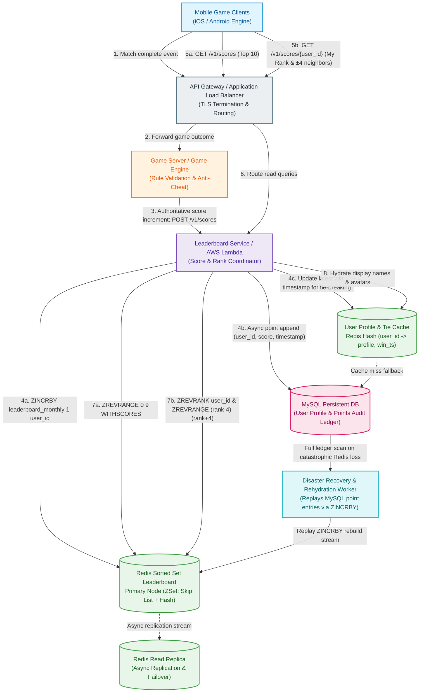
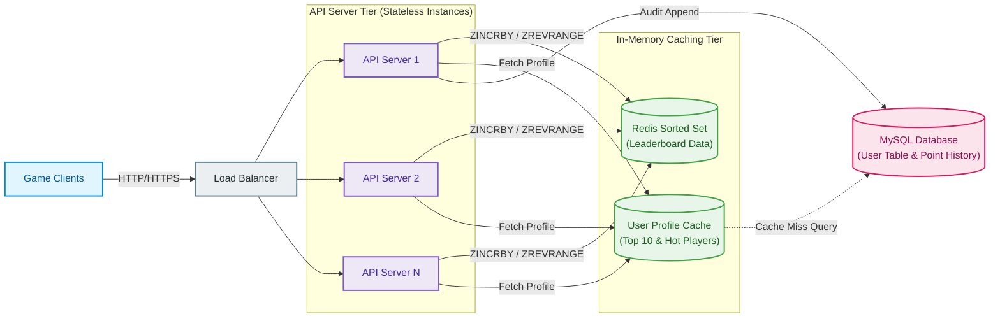
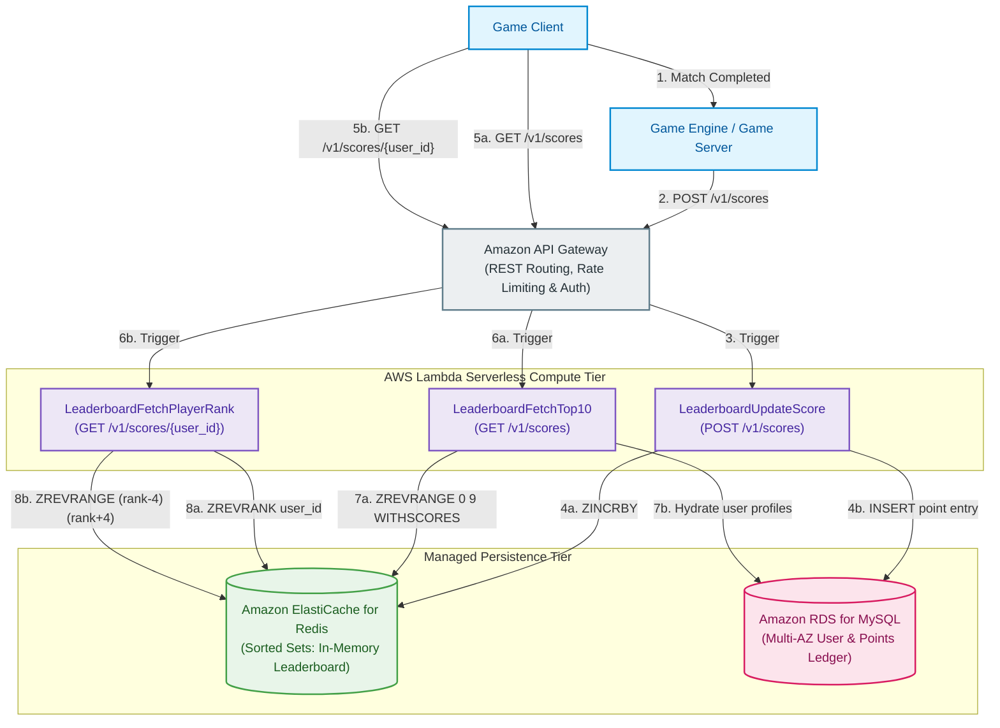
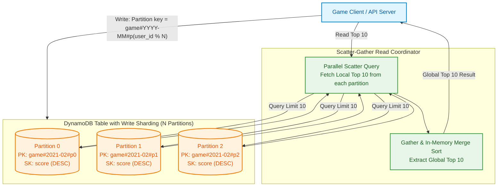
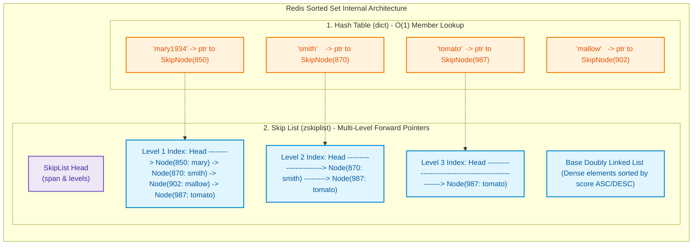
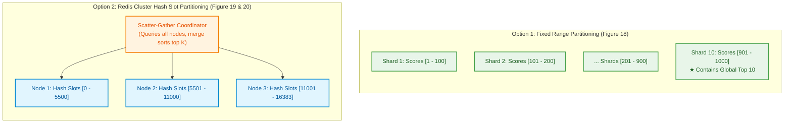
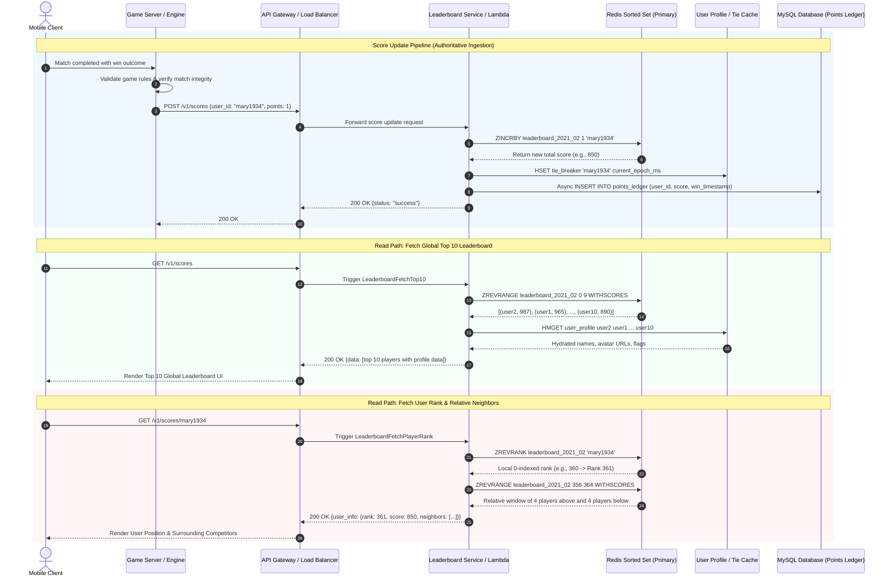
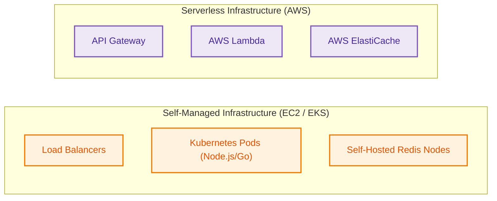
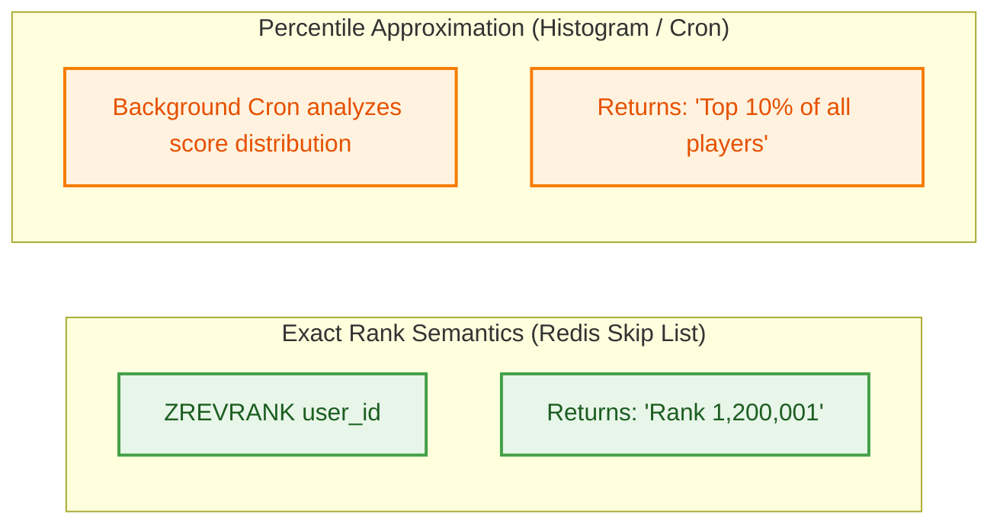
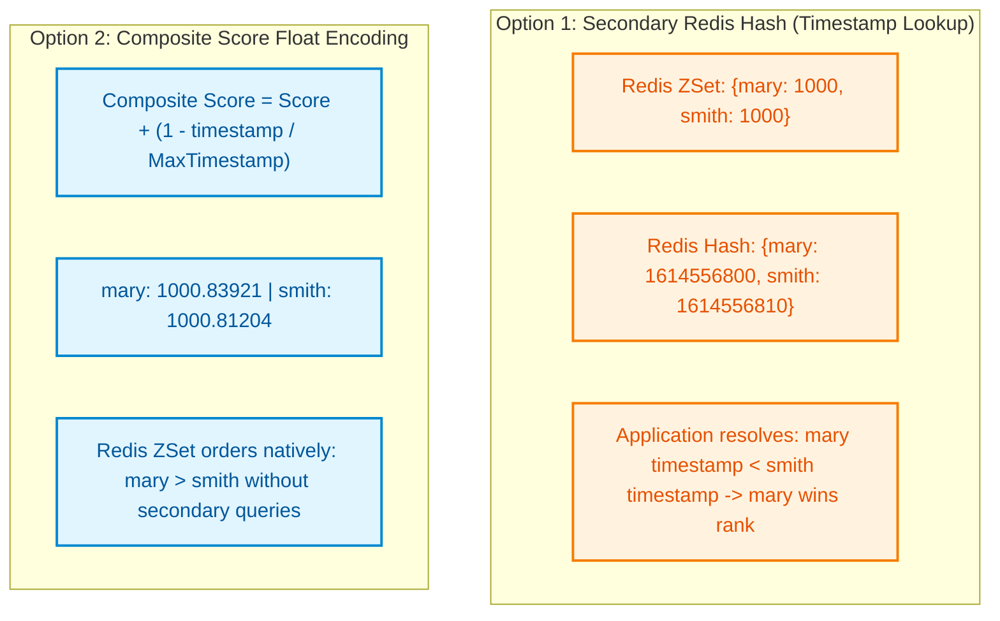

# Real-Time Gaming Leaderboard: Figure 15 & 16-17 Final Design Architecture

> **Reference Source**: *System Design Interview – An Insider's Guide: Volume 2*, Chapter 10: *Real-time Gaming Leaderboard*  
> **Source Material**: `Game Board/System design-2-chapter 10.pdf` (Pages 19–22, Figures 15, 16, 17; Pages 26–30, Figures 21–25)

---

## 1. End-to-End System Architecture (Figure 15 & Figures 16–17)

The Real-Time Gaming Leaderboard system is designed to track player scores, calculate instantaneous global rankings, return surrounding player positions, and render top-N tournament standings for massive multiplayer mobile games. The architecture scales from a standard baseline of **5 million Daily Active Users (DAU)** / **25 million Monthly Active Users (MAU)** (handling 2,500 peak write QPS and ~650 MB in-memory footprint) up to an enterprise scale of **500 million DAU** (250,000 peak write QPS and ~65 GB distributed footprint).

The system decouples **gameplay logic** from **leaderboard computation**, enforces **server-authoritative score submissions** to eliminate client tampering, leverages **in-memory sorted sets (Skip List + Hash Table)** for sub-millisecond $O(\log N)$ rank updates and range queries, and maintains persistent backing storage in **MySQL/DynamoDB** for historical game logs and disaster recovery.



---

## 2. Key Subsystem Deep Dives & Architectural Variants

### 2.1 Variant A Architecture: Self-Managed Dedicated Microservices (Figure 15)

In an on-premise or dedicated infrastructure deployment, the system employs long-running stateless microservice instances behind standard Application Load Balancers.



#### Operational Mechanics:
1. **Routing Tier**: The Load Balancer terminates incoming TLS traffic and balances HTTP REST requests across the stateless API server cluster.
2. **Monthly Partitioning**: Each month kicks off a new tournament. The API server generates a dedicated Redis Sorted Set key: `leaderboard_{YYYY_MM}`. Historical monthly sets are persisted or migrated to cold storage.
3. **Data Hydration**: Sorted sets only store `user_id` and numeric `score`. To render the UI, the API servers query `User Profile Cache` (Redis Hash) for player avatars and display names. On cache miss, they query MySQL and warm the cache.
4. **Resiliency**: The primary Redis node streams changes to read replicas. If the primary crashes, Sentinel/Cluster failover promotes the replica.

---

### 2.2 Variant B Architecture: Cloud-Native Serverless Architecture (Figures 16 & 17)

When built entirely on public cloud infrastructure (e.g., AWS), the application layer is replaced by fully managed serverless components, eliminating server provisioning, patching, and capacity planning.



#### Lambda Function Mapping Table:
| REST API Route | HTTP Method | AWS Lambda Handler | Execution Target & Operation |
| :--- | :--- | :--- | :--- |
| `/v1/scores` | `POST` | `LeaderboardUpdateScore` | `ZINCRBY leaderboard_<month> <points> <user_id>` + MySQL audit insert. |
| `/v1/scores` | `GET` | `LeaderboardFetchTop10` | `ZREVRANGE leaderboard_<month> 0 9 WITHSCORES` + profile hydration. |
| `/v1/scores/{user_id}` | `GET` | `LeaderboardFetchPlayerRank` | `ZREVRANK` (current rank) + `ZREVRANGE (rank-4) (rank+4)` (neighbors). |

---

### 2.3 Variant C Architecture: NoSQL Write-Sharded Architecture (Figures 21–25)

An alternative to Redis is a managed NoSQL store such as **Amazon DynamoDB**, Cassandra, or MongoDB. DynamoDB provides native high-write throughput and automatic partitioning via consistent hashing. However, querying global top scores across a distributed NoSQL table requires **Global Secondary Indexes (GSI)** and **Write Sharding**.



#### NoSQL Schema Evolution:
1. **Initial Denormalized Table (Figure 22)**:
   - Primary Key: `user_id`. Attributes: `score`, `game_name`, `updated_at`.
   - *Limitation*: Finding the top 10 requires an exhaustive table scan across all rows ($O(N)$), which collapses under millions of entries.
2. **Global Secondary Index (GSI) Attempt (Figure 23)**:
   - Partition Key: `game_name#{year-month}`. Sort Key: `score`.
   - *Limitation*: All writes for the current active tournament map to the **same single partition key**, generating an extreme **hot partition** that throttles write throughput.
3. **Write Sharded GSI (Figure 24 & 25)**:
   - Partition Key: `game_name#{year-month}#p{partition_number}` where `partition_number = user_id % N`.
   - Sort Key: `score`.
   - Read Path: Employs **Scatter-Gather**. The client concurrently fires $N$ queries for the top 10 scores within each shard, receives $10 \times N$ candidates, and performs an in-memory merge sort to extract the true global top 10.

---

### 2.4 Internal Data Structure Deep Dive: Redis Sorted Set (Skip List + Hash Table)

A Redis Sorted Set (`zset`) delivers deterministic logarithmic performance because it pairs two complementary internal data structures:



#### Skip List Search Efficiency:
- **Hash Table (`dict`)**: Maps each member string (`user_id`) to their respective score and skip list node pointer. Provides $O(1)$ score lookup.
- **Skip List (`zskiplist`)**: Maintains a hierarchy of forward pointers. Each level skips approximately half the nodes of the level below (similar to binary search over linked lists).
- **Complexity**:
  - Traversal to find a node by rank or score requires $O(\log N)$ hops (traversing ~11 nodes across a 5-level index for 62 elements; at 25 million users, $\approx \log_2(25,000,000) \approx 25$ pointer jumps).
  - Insertion and deletion run in $O(\log N)$ time with localized pointer reassignment, avoiding the massive node-shifting penalties of contiguous arrays or complex balance rotations of AVL/Red-Black trees.
  - Skip list nodes also store a **`span`** property on each forward pointer, which tracks how many low-level nodes are bypassed. This allows Redis to compute exact ranks (`ZRANK`/`ZREVRANK`) in $O(\log N)$ by simply summing spans along the search path!

---

### 2.5 Scaling Redis to 500 Million DAU: Fixed Partition vs. Hash Partition

When scaling 100x from 5M to 500M DAU, memory footprint rises to ~65 GB (worst case) and update traffic hits **250,000 QPS**. A single Redis server cannot sustain this throughput. The chapter evaluates two distinct sharding architectures:



#### Detailed Operational Comparison:
1. **Fixed Score-Range Partitioning (Author Recommended)**:
   - **Sharding Rule**: Scores are bucketed by range (e.g., Shard 1: 1–100, Shard 2: 101–200, ..., Shard 10: 901–1000).
   - **Write Mechanics**: An auxiliary lookup cache (`user_id -> score`) determines the user's current shard. When `ZINCRBY` causes a user's score to cross a boundary, the application removes them from the old shard (`ZREM`) and inserts them into the higher shard (`ZADD`).
   - **Global Top 10 Query**: Trivial $O(1)$ query directed solely to the highest shard (Shard 10). No cross-shard scatter-gather required.
   - **Exact Rank Query**: Local rank within the user's shard via `ZREVRANK`, added to the total player counts of all higher shards. Higher shard populations are fetched in $O(1)$ using Redis `INFO keyspace` or `ZCARD`.
2. **Hash Slot Partitioning (Redis Cluster)**:
   - **Sharding Rule**: Shards by `CRC16(user_id) % 16384`.
   - **Write Mechanics**: Uniform write distribution across all cluster nodes. Single `ZINCRBY` executed directly on the target hash slot.
   - **Limitations**: Top 10 query requires Scatter-Gather across all nodes, suffering from tail latency (waiting for the slowest shard). Furthermore, calculating an exact user rank is computationally intractable because scores are scattered uniformly across all nodes.

---

## 3. In-Depth Step-by-Step Pipeline Description



### Step 1: Game Server Match Completion & Integrity Verification
* **Payload / Data Model**: The game client reports gameplay actions (e.g., game duration, moves, signature token).
* **Network & Protocols**: WebSocket connection or encrypted UDP/TCP stream to dedicated Game Servers.
* **Security & Anti-Cheat Enforcement**:
  > [!IMPORTANT]
  > **Security Rule: Never Trust the Client for Score Submissions**:
  > Allowing the mobile client to invoke `POST /v1/scores` directly opens the system to trivial **Man-in-the-Middle (MITM)** attacks and memory-injection exploits (e.g., Cheat Engine, proxy interception via Charles/Burp Suite). The score increment must **exclusively be submitted by internal authoritative game servers** after server-side validation.

### Step 2: Ingestion & Routing via API Gateway / Load Balancer
* **Payload**: `POST /v1/scores` with JSON payload `{"user_id": "mary1934", "points": 1}`.
* **Network & Security**: HTTPS REST endpoint secured via internal VPC peering, mutual TLS (mTLS), or internal API Gateway tokens. External public clients are blocked at the firewall.
* **Buffering & Concurrency**: In high-throughput turn-based or multiplayer tournaments, an optional Kafka topic can decouple the game servers from the leaderboard service, absorbing spikes during global tournament endings.

### Step 3: Atomic In-Memory Score Update (`ZINCRBY`)
* **Execution**: `ZINCRBY leaderboard_2021_02 1 'mary1934'`.
* **Algorithmic Complexity**: $O(\log N)$ where $N$ is the monthly active users in the sorted set.
* **Storage Modification**:
  - The hash table locates the node pointer in $O(1)$.
  - The node's score is updated from $S$ to $S+1$.
  - The skip list adjusts forward/backward pointers and level spans to position the node in its new sorted position in $O(\log N)$.
* **Tie-Breaking Update**: In parallel, the worker updates a Redis Hash storing `user_id -> last_win_timestamp` (`HSET leaderboard_ties mary1934 <timestamp>`). If two players share identical scores, the player with the earlier timestamp is ranked higher.

### Step 4: Persistent Audit Logging in Relational DB
* **Schema**:
  ```sql
  CREATE TABLE points_ledger (
      entry_id BIGINT AUTO_INCREMENT PRIMARY KEY,
      user_id VARCHAR(24) NOT NULL,
      score_delta INT NOT NULL,
      win_timestamp TIMESTAMP DEFAULT CURRENT_TIMESTAMP,
      INDEX idx_user_time (user_id, win_timestamp)
  );
  ```
* **Buffering & Backpressure**: Writes to the points ledger are executed asynchronously or batched via connection pooling so that database disk I/O never blocks the real-time Redis update path.
* **Purpose**: Serves as the authoritative source of truth for dispute arbitration, historical player progression, and disaster recovery.

### Step 5: Read Path A - Fetch Global Top 10 Leaderboard
* **Execution**: Client invokes `GET /v1/scores`.
* **Redis Command**: `ZREVRANGE leaderboard_2021_02 0 9 WITHSCORES`.
* **Complexity**: $O(\log N + M)$ where $M=10$. Because $M$ is tiny, retrieval completes in under 1 millisecond.
* **Profile Hydration**: Leaderboard service executes a pipelined `HMGET user_profiles user2 user1 ... user10` to retrieve names and avatars in a single round-trip.

### Step 6: Read Path B - Fetch User Rank & Surrounding Window (±4 Neighbors)
* **Execution**: Client invokes `GET /v1/scores/mary1934`.
* **Rank Command**: `ZREVRANK leaderboard_2021_02 'mary1934'`. Redis calculates the rank by traversing the skip list and summing pointer spans in $O(\log N)$. Result is 0-indexed (add 1 for display rank).
* **Relative Window Command**: To display 4 players above and 4 players below user at rank 361 (0-indexed index 360):
  ```text
  ZREVRANGE leaderboard_2021_02 356 364 WITHSCORES
  ```
  Returns exactly 9 entries (indices 356 through 364), placing the target player in the exact center of the rendered bracket.

### Step 7: System Failure Recovery & Disaster Rehydration
* **Failure Scenario**: Entire Redis cluster crashes, or an unrecoverable node corruption occurs without usable RDB/AOF snapshots.
* **Reconstruction Pipeline**:
  1. A disaster recovery script launches offline.
  2. The worker streams all winning rows from the MySQL `points_ledger` table partitioned by `win_timestamp`.
  3. The worker issues pipelined `ZINCRBY` commands to a freshly provisioned Redis instance.
  4. Once catch-up replication reaches parity with live game servers, traffic is cut over to the restored Redis cluster.

---

## 4. Comprehensive Architectural Trade-Off Analysis

### 4.1 Storage Engine: Redis Sorted Sets vs. Relational DB (MySQL) vs. NoSQL (DynamoDB)

| Evaluation Dimension | Relational DB (MySQL) | Redis Sorted Sets (`zset`) | NoSQL (DynamoDB with GSI) | Distributed Cache + Custom Heap |
| :--- | :--- | :--- | :--- | :--- |
| **Write Performance (Peak 2,500 - 250k QPS)** | **Poor**: $B^+$-Tree updates cause heavy page splits and disk I/O; table locking under high write concurrency. | **Exceptional**: Purely in-memory; atomic $O(\log N)$ updates via skip list pointer swaps. | **Good**: High write throughput, but requires write sharding to avoid hot partition throttling. | **Moderate**: Requires manual locking and cross-node cache invalidation logic. |
| **Rank Calculation (`ZRANK` / Position)** | **Terrible**: Requires full table scan or nested query `COUNT(*) WHERE score >= my_score` taking tens of seconds. | **Optimal**: $O(\log N)$ using internal skip list level spans; instant sub-millisecond resolution. | **Poor**: Cannot natively compute exact global ranks across shards without scanning; limited to percentiles. | **Complex**: Requires maintaining distributed order-statistic trees across cluster nodes. |
| **Top 10 Retrieval Latency** | **Moderate**: Fast with index and `LIMIT 10`, but degrades as write contention locks index pages. | **Instantaneous**: `ZREVRANGE 0 9` takes $< 0.5\text{ ms}$ ($O(\log N + 10)$). | **Moderate**: Requires Scatter-Gather across $N$ partitions and application-level merge sort. | **Fast**: Top-N can be maintained in local min-heap memory. |
| **Memory / Storage Cost** | **Low**: Stored on commodity SSDs. | **High**: Entire leaderboard dataset must reside in RAM (~650 MB for 25M users; 65 GB for 500M users). | **Medium**: Pay-per-write and storage; scales linearly. | **High**: Redundant memory consumption across all instances. |
| **Durability & Persistence** | **Native**: ACID transactions, WAL, Multi-AZ replication. | **In-Memory**: Relies on asynchronous RDB snapshots or AOF; slow recovery from disk on cold restart. | **Native**: Multi-AZ automated replication with 99.999% durability SLA. | **Ephemeral**: Requires external persistent database backing. |
| **Winner & Decision Rule** | **Rejected**: Cannot support real-time ranking at scale. | **Winner for Primary Architecture**: Redis Sorted Sets provide the only native $O(\log N)$ rank calculation. | **Viable Alternative**: Recommended if organization mandates pure serverless NoSQL and accepts percentile ranks. | **Rejected**: Too complex to build and maintain distributed tree structures. |

---

### 4.2 Score Ingestion Authority: Server-Authoritative Game Engine vs. Direct Client Ingestion

| Dimension | Option A: Client-Reported Score (`POST /v1/scores` from Mobile) | Option B: Server-Authoritative Game Engine (`POST /v1/scores` from Server) | Winner & Decision Rule |
| :--- | :--- | :--- | :--- |
| **Cheat & Tamper Resistance** | Zero protection; vulnerable to local memory editing, proxy interception, and replay attacks. | High protection; game engine computes win conditions independently based on signed move inputs. | **Option B wins** |
| **Network Overhead** | Low; mobile client calls API Gateway directly. | Higher; game client connects to game server, which in turn calls leaderboard service. | **Option A wins on raw hops, but rejected due to security** |
| **Authorization Boundaries** | Requires exposing public write endpoints with complex token validation. | Ingestion endpoint is entirely private, secured inside internal VPC with mTLS. | **Option B wins** |
| **Offline Game Play** | Client can cache wins and burst-upload when reconnected. | Harder to validate offline play without server-side verification tokens. | **Trade-off depends on game type** |
| **Verdict** | **Strictly Rejected for competitive leaderboards.** | **Mandatory Standard**: Server-authoritative ingestion is essential to prevent cheating. | **Option B wins decisively** |

---

### 4.3 Architecture Tiering: Self-Managed Instances vs. Cloud-Native Serverless



| Dimension | Self-Managed (EC2 / Kubernetes) | Cloud-Native Serverless (API Gateway + AWS Lambda) | Winner & Decision Rule |
| :--- | :--- | :--- | :--- |
| **Operational Maintenance** | High; requires OS patching, AMI maintenance, cluster autoscaling, and connection pool tuning. | Zero server administration; cloud provider handles execution environments and scaling. | **Serverless wins** |
| **Traffic Scalability** | Requires horizontal pod autoscaling (HPA) with warm-up delays during traffic spikes. | Instantaneous concurrency scaling per incoming request burst up to regional limits. | **Serverless wins** |
| **Cold Start Latency** | None; long-running daemon processes maintain pre-warmed JVM/Go runtimes. | Occasional cold starts (50–300 ms) when new Lambda microVMs are initialized. | **Self-Managed wins** |
| **Cost at Constant High Load** | Significantly cheaper per request at steady-state high utilization. | Expensive at continuous high QPS due to per-millisecond Lambda invocation pricing. | **Self-Managed wins at scale; Serverless wins at low/variable load** |
| **Database Connection Exhaustion** | Managed via stable connection pools maintained by long-lived servers. | Ephemeral Lambdas can flood Redis/MySQL with connections; requires RDS Proxy / Redis connection pooling. | **Self-Managed wins** |
| **Verdict** | **Best for established gaming studios with dedicated DevOps and massive steady traffic.** | **Best for greenfield games, variable traffic, or small teams prioritizing zero ops.** | **Context-dependent** |

---

### 4.4 Sharding Strategy at Extreme Scale (500M DAU): Fixed Partition vs. Hash Partition

| Dimension | Option A: Fixed Score-Range Partitioning | Option B: Redis Cluster Hash Slot Partitioning | Option C: DynamoDB Write Sharding |
| :--- | :--- | :--- | :--- |
| **Partitioning Logic** | Application shards by score brackets: `[1-100]`, `[101-200]`, ..., `[901-1000]`. | Distributed by `CRC16(user_id) % 16384` across Redis Cluster nodes. | Partition key: `game#{month}#p(user_id % N)`. |
| **Top 10 Fetch Complexity** | **$O(1)$ Single Shard**: Top 10 is queried only from the highest active shard (e.g., Shard 10). | **$O(N)$ Scatter-Gather**: Must query Top 10 from all shards, transmit over network, and merge sort. | **$O(N)$ Scatter-Gather**: Queries all $N$ partition GSIs and merges in memory. |
| **User Exact Rank Query** | **$O(1)$ Mathematical Sum**: Local rank in shard + `INFO keyspace` element counts of higher shards. | **Computationally Infeasible**: Scores are randomly scattered; requires scanning all nodes. | **Not Supported**: Only percentile approximations are feasible. |
| **Write Update Complexity** | **Moderate**: Requires tracking user's score to detect shard boundaries; cross-shard move requires `ZREM` + `ZADD`. | **Simple**: Single atomic `ZINCRBY` directly routed to the target hash slot. | **Simple**: Write directed to single partition based on `user_id % N`. |
| **Hotspot Risk** | High if score distribution is uneven (requires dynamic score range rebalancing). | Uniform distribution across all nodes; zero hotspot risk. | Uniform distribution across write partitions. |
| **Tail Latency Sensitivity** | Low; single node query. | High; query latency is bounded by the slowest responding partition. | High; bounded by the slowest GSI partition read. |
| **Verdict** | **Recommended by Author**: Delivers direct Top 10 and exact user rank without scatter-gather overhead. | Rejected for global Top-N due to high tail latency and inability to rank users. | Good for NoSQL environments willing to accept percentile rank semantics. |

---

### 4.5 Ranking Semantics: Exact Rank vs. Percentile Approximation



| Evaluation Dimension | Exact Rank (`ZREVRANK`) | Percentile Approximation (Histogram / Cron) |
| :--- | :--- | :--- |
| **User Psychological Value** | High at the top (Rank 1 to 100); low and demotivating at the bottom (e.g., Rank 3,452,192). | High for middle/lower tier players ("You are in the Top 15%!"); motivating and easy to interpret. |
| **Computational Overhead** | High at massive scale; requires maintaining synchronized distributed trees or fixed score bounds. | Extremely low; background cron updates score distribution histogram once every 10–30 minutes. |
| **Storage & Sharding Flexibility** | Constrains sharding to fixed score ranges or single-instance sets. | Allows arbitrary hash sharding across DynamoDB or Redis without cross-shard rank coordination. |
| **Read Latency** | $O(\log N)$ or multi-shard count aggregation. | $O(1)$ memory lookup against cached percentile boundaries (`score >= 5000 -> Top 10%`). |
| **Recommended Hybrid Model** | **Provide exact ranks for Top 1,000 players; switch to percentile rankings for all players below Rank 1,000.** |

---

### 4.6 Dual-Write Synchronization: Synchronous Dual-Write vs. Asynchronous Queue

| Dimension | Alternative A: Synchronous Dual-Write (Lambda writes Redis + MySQL) | Alternative B: Asynchronous Message Queue (Kafka / SQS Buffering) | Winner & Decision Rule |
| :--- | :--- | :--- | :--- |
| **Write Latency** | Higher; client waits for both Redis in-memory update and MySQL disk commit. | Minimal; service writes to Redis and emits event to Kafka; background worker persists to DB. | **Alternative B wins** |
| **Failure Decoupling** | MySQL slowdown or outage directly blocks real-time score updates. | MySQL downtime has zero impact on live leaderboard gameplay; events queue up safely in Kafka. | **Alternative B wins** |
| **Dual-Write Inconsistency** | If Redis succeeds but MySQL fails (or vice versa), state drifts out of sync. | Kafka ensures at-least-once delivery; idempotent database consumers eliminate state drift. | **Alternative B wins** |
| **Infrastructure Complexity** | Low; no message brokers to operate. | Higher; requires provisioning and monitoring Kafka/SQS clusters and consumer worker fleets. | **Alternative A wins on simplicity** |
| **Multi-Consumer Extensibility** | None; adding analytics, push notifications, or anti-cheat requires altering API code. | High; multiple independent microservices subscribe to the same score event stream (Figure 4). | **Alternative B wins decisively** |

---

### 4.7 Tie-Breaking Implementations

When multiple players achieve identical scores, tournament integrity demands a deterministic ranking tie-breaker.



| Technique | Implementation Mechanics | Pros | Cons & Pitfalls |
| :--- | :--- | :--- | :--- |
| **1. Secondary Redis Hash (Author Proposal)** | Redis Sorted Set holds raw integer score. A secondary Redis Hash stores `user_id -> last_win_epoch_ms`. | Clean score presentation; easy to inspect and debug. | Requires application-level tie resolution when sorting identical scores. |
| **2. Fractional Score Encoding** | Score is encoded as: $\text{EffectiveScore} = \text{Score} + \left(1 - \frac{\text{Timestamp}}{\text{MaxTimestamp}}\right)$. | Redis Sorted Set orders ties **natively** in $O(\log N)$ without auxiliary queries or application code. | IEEE 754 64-bit float precision limitations (double precision has 53 bits of mantissa; large scores cause timestamp truncation). |
| **3. Lexicographical Fallback** | When scores are identical, Redis defaults to lexicographical ordering of the member string (`user_id`). | Zero overhead; built into Redis natively. | Unfair to players; ranking is biased by alphabetical username sorting. |

---

### 4.8 Build vs. Buy Decisions

| Component Tier | Build In-House (Custom Solution) | Buy / Adopt Managed Service | Strategic Recommendation |
| :--- | :--- | :--- | :--- |
| **Leaderboard In-Memory Store** | Custom distributed Skip List service written in C++/Rust with gRPC interfaces. | **Amazon ElastiCache for Redis / Redis Enterprise Cloud**. | **Adopt Managed Redis**: Redis Sorted Sets are battle-tested over a decade, memory-efficient, and natively solve $O(\log N)$ ranking. Custom engines introduce enormous maintenance debt. |
| **Compute & API Tier** | Custom microservices deployed on self-managed EC2/Kubernetes nodes. | **AWS Lambda + Amazon API Gateway**. | **Hybrid Approach**: Adopt AWS Lambda for greenfield development or low-to-medium scale. Migrate to Kubernetes (EKS) when continuous high QPS makes Lambda invocation costs prohibitive. |
| **Persistent Ledger** | Custom append-only flat file log on distributed NVMe storage. | **Amazon RDS (MySQL Multi-AZ) or Amazon DynamoDB**. | **Adopt Managed Database**: Use RDS for relational ACID audit logging or DynamoDB for effortless horizontal write scaling. |
| **Cache Hydration & CDN** | Custom distributed reverse-proxy caching layer. | **Amazon CloudFront + ElastiCache Redis Profile Cache**. | **Adopt Managed CDN & Redis**: Static assets (avatars) cached at Edge; profile metadata cached in Redis Hash. |

---

## 5. Summary Table of Key Architectural Decisions

| System Layer | Selected Architecture / Technology | Primary Justification | Rejected Alternatives & Disqualification Rationale |
| :--- | :--- | :--- | :--- |
| **Score Ingestion Authority** | **Server-Authoritative Game Server** | Eliminates client-side memory tampering, proxy packet sniffing, and Man-in-the-Middle (MITM) attacks. | **Direct Client Ingestion (`POST /v1/scores`)**: Rejected due to catastrophic cheating vulnerability. |
| **Core Leaderboard Store** | **Redis Sorted Sets (`zset`)** | Dual data structure (Skip List + Hash Table) delivers atomic $O(\log N)$ rank lookups, updates, and range extractions. | **MySQL Relational Database**: Rejected because ranking queries take tens of seconds over millions of rows ($O(N)$ scans). |
| **Tournament Periodicity** | **Monthly Key Partitioning (`leaderboard_{YYYY_MM}`)** | Isolates active tournament traffic; simplifies end-of-month archival and memory cleanup. | **Single Monolithic Set**: Rejected due to unbounded memory growth and historical bloat. |
| **Compute Tier (Standard Scale)** | **AWS Lambda + API Gateway** | Fully managed serverless execution; auto-scales dynamically with active tournament spikes with zero server ops. | **Self-Managed EC2 Clusters**: Higher operational complexity for teams without dedicated platform engineers. |
| **Scaling Architecture (500M DAU)** | **Fixed Score-Range Sharding (`[1-100]`, ..., `[901-1000]`)** | Enables $O(1)$ global Top 10 retrieval and mathematical exact user rank calculation without scatter-gather. | **Redis Cluster Hash Partitioning**: Rejected because scatter-gather causes high tail latency and cannot compute user ranks. |
| **Alternative NoSQL Store** | **DynamoDB with Write-Sharded GSI (`game#month#p{n}`)** | Evenly distributes extreme write volume across partitions using hash suffixes. | **Single Partition Key GSI**: Rejected due to hot partition write throttling. |
| **Disaster Recovery Strategy** | **MySQL Points Ledger + Replay Worker** | Persistent database logs every match win with timestamps, enabling full offline cache rebuild via `ZINCRBY`. | **Redis Disk Snapshots (RDB/AOF) Alone**: Slow to restore from disk; snapshot corruption risks permanent tournament data loss. |
| **Profile Data Hydration** | **Redis Hash User Profile Cache** | Avoids hammering MySQL with read queries for display names and avatars during Top 10 rendering. | **Denormalizing Profile Data into Sorted Set**: Bloats sorted set memory footprint; updates to usernames force re-indexing. |
| **Tie-Breaking Strategy** | **Redis Hash Win-Timestamp Lookup** | Deterministic resolution: earlier win timestamp breaks score ties fairly without float precision bugs. | **Lexicographical Username Ordering**: Unfair arbitrary bias based on alphabetical player handles. |
