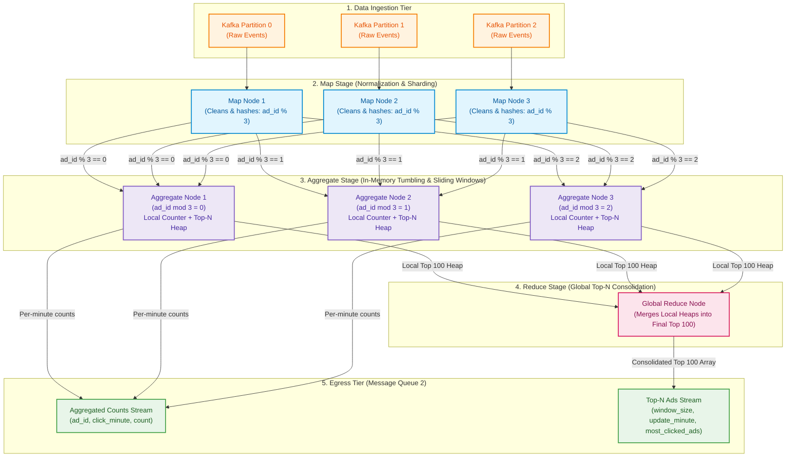
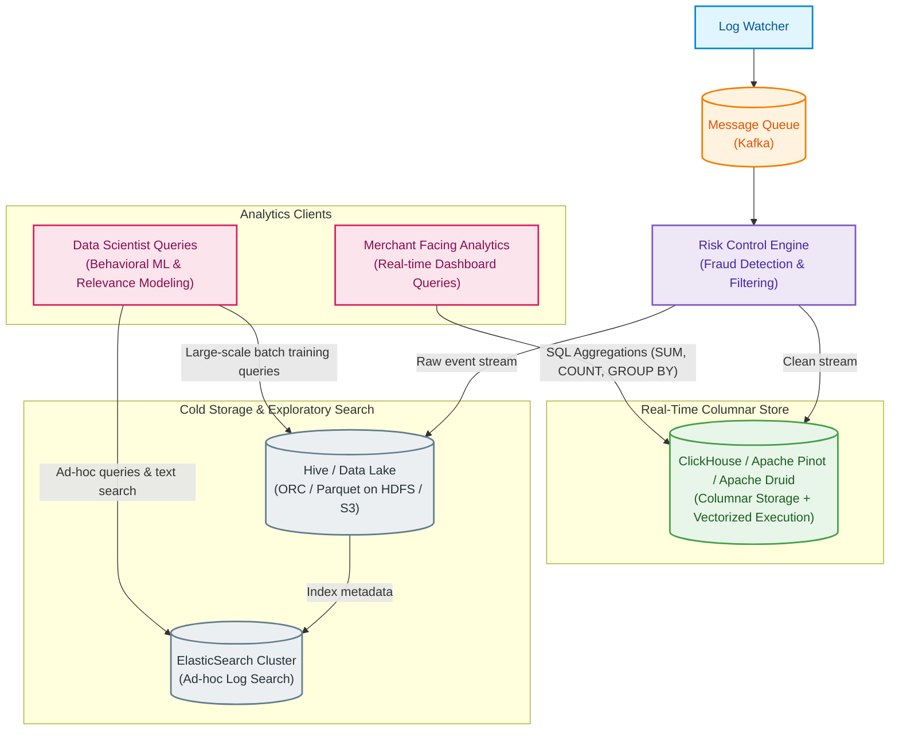
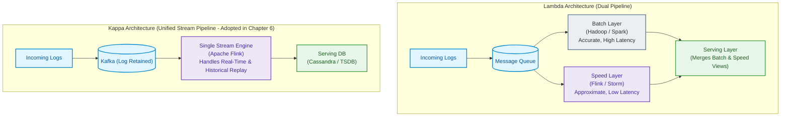
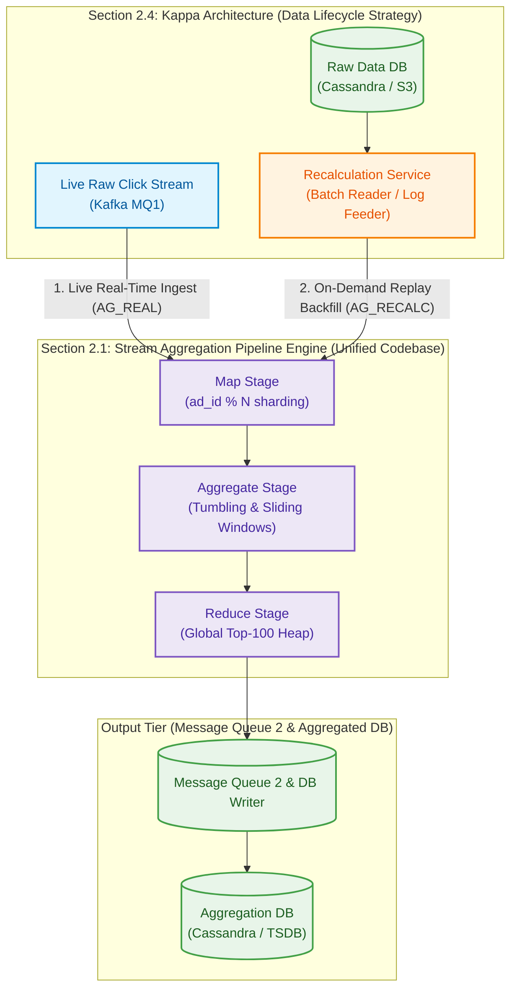
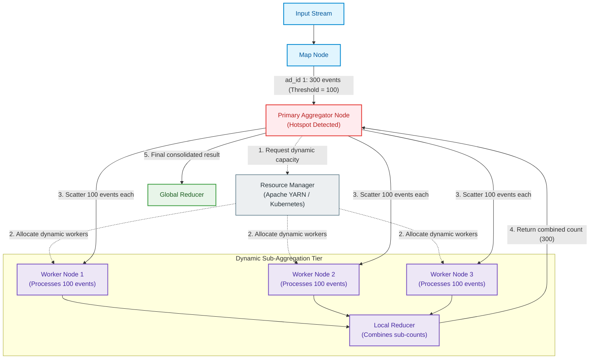
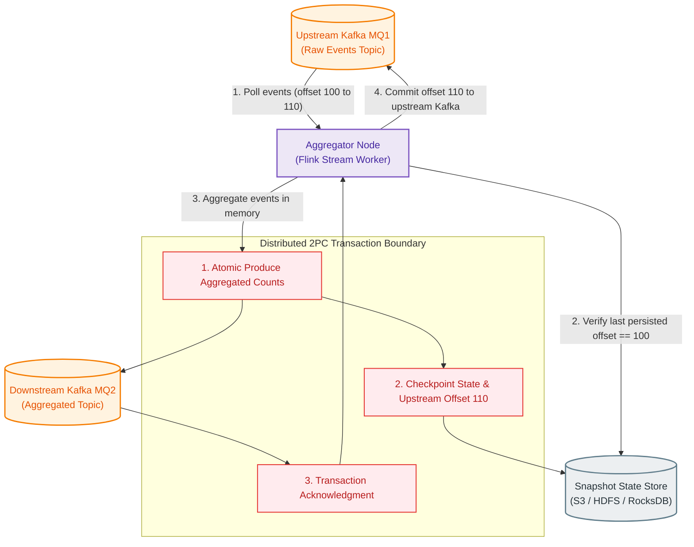

# Ad Click Event Aggregation System: Figure 28 Final Design Architecture

> **Reference Source**: *System Design Interview – An Insider's Guide: Volume 2*, Chapter 6: *Ad Click Event Aggregation*  
> **Source Material**: `Stream/System Design Interview – chapter 6.pdf` (Page 38, Figure 28 & Page 39, Figure 29)

---

## 1. End-to-End System Architecture (Figure 28)

The Ad Click Event Aggregation System processes unbounded real-time ad click streams at global scale (1 billion daily clicks, 10,000 average QPS, 50,000 peak QPS across 2 million active advertisements). It provides real-time aggregations (e.g., click counts per minute, top 100 most-clicked ads) for real-time bidding (RTB) performance, merchant analytics dashboards, and billing reconciliation, while upholding **end-to-end exactly-once semantics**.

```mermaid
flowchart LR
    classDef sourceStyle fill:#e1f5fe,stroke:#0288d1,stroke-width:2px,color:#01579b
    classDef bufferStyle fill:#fff3e0,stroke:#f57c00,stroke-width:2px,color:#e65100
    classDef streamStyle fill:#ede7f6,stroke:#7e57c2,stroke-width:2px,color:#4527a0
    classDef rawStoreStyle fill:#eceff1,stroke:#607d8b,stroke-width:2px,color:#263238
    classDef aggStoreStyle fill:#e8f5e9,stroke:#43a047,stroke-width:2px,color:#1b5e20
    classDef queryStyle fill:#fce4ec,stroke:#d81b60,stroke-width:2px,color:#880e4f
    classDef reconStyle fill:#f3e5f5,stroke:#8e24aa,stroke-width:2px,color:#4a148c
    classDef replayStyle fill:#e0f7fa,stroke:#00acc1,stroke-width:2px,color:#006064

    %% Node Declarations
    LW["Log Watcher<br>(File Tailer Daemon)"]:::sourceStyle
    MQ1[("Message Queue 1<br>(Raw Events Topic)")]:::bufferStyle
    
    DBW_RAW["Database Writer<br>(Raw Ingest Worker)"]:::rawStoreStyle
    RAW_DB[("Raw Data Database<br>(Cassandra / S3 Parquet)")]:::rawStoreStyle

    AG_REAL["Data Aggregation Service<br>(Real-Time MapReduce / Flink)"]:::streamStyle
    
    MQ2[("Message Queue 2<br>(Aggregated Topic)")]:::bufferStyle
    
    DBW_AGG["Database Writer<br>(Aggregated DB Sink)"]:::aggStoreStyle
    AGG_DB[("Aggregation Database<br>(Cassandra / TSDB)")]:::aggStoreStyle
    
    RECALC["Recalculation Service<br>(Historical Batch Replay)"]:::replayStyle
    AG_RECALC["Data Aggregation Service<br>(Dedicated Replay Node)"]:::replayStyle

    QS["Query Service<br>(Advertiser Dashboard API)"]:::queryStyle
    RECON["Reconciliation Service<br>(EOD Audit Batch Job)"]:::reconStyle

    %% Real-Time Pipeline Connections
    LW -->|"Tail log lines & publish"| MQ1
    MQ1 -->|"Subscribe raw streams"| AG_REAL
    MQ1 -->|"Subscribe for archival"| DBW_RAW
    DBW_RAW -->|"Append raw records"| RAW_DB

    AG_REAL -->|"Per-minute click counts"| MQ2
    AG_REAL -->|"Top 100 clicked ads"| MQ2

    MQ2 -->|"Poll aggregated batches"| DBW_AGG
    DBW_AGG -->|"Atomic transactional write"| AGG_DB
    AGG_DB -->|"Fetch metrics"| QS

    %% Historical Replay / Recalculation Connections
    RAW_DB -->|"Read historical range"| RECALC
    RECALC -->|"Push replay batches"| AG_RECALC
    AG_RECALC -->|"Publish recomputed counts"| MQ2

    %% Reconciliation Verification Connections
    RAW_DB -->|"1. Read raw events & sort by event time"| RECON
    AGG_DB -->|"2. Compare aggregated metrics"| RECON
```



---

## 2. Key Subsystem Deep Dives & Architectural Variants

### 2.1 Variant A Architecture: Stream Aggregation Pipeline (Figure 5, 8, 9, 22)
In the primary design, computation occurs **at ingestion time** using a Directed Acyclic Graph (DAG) MapReduce model (exemplified by Apache Flink or Kafka Streams).



#### Stream Aggregation Operational Mechanics:
1. **Map Processing**: Map nodes read from Kafka, sanitize fields, discard corrupted payloads, and route events using consistent hashing on `ad_id` (`ad_id % N`). This ensures all click records for a specific ad converge on the exact same Aggregate node.
2. **In-Memory Window Aggregation (Concurrent Coexistence)**:
   A foundational architectural mechanism in Chapter 6 is that **the Tumbling Window and Sliding Window exist and execute concurrently at the exact same time** within each Aggregate node. They do not compete with or replace one another; instead, they process the exact same ingested click stream to fulfill two distinct business use cases simultaneously:

   - **Tumbling Window (1-Minute Fixed Chunks — Use Case 1: Billing & Accurate Counts)**:
     - **Operational Role**: Partitions time into non-overlapping, continuous 1-minute chunks (`12:00–12:01`, `12:01–12:02`).
     - **Why Required**: Mandatory for **advertiser invoicing, financial billing, and reconciliation**. Because windows never overlap, every click belongs to strictly one discrete bucket, eliminating any risk of double-billing advertisers.
     - **State Mechanics**: Maintains an in-memory hash map `{ad_id: click_count}` for minute T. Upon window close (T + 1 min + 15s watermark delay), it flushes aggregated records to Kafka MQ2 topic `ad_clicks_aggregated_minute`, which are written to Cassandra's `ad_clicks_aggregated` table.
   
   - **Sliding Window (M-Minute Rolling Chunks — Use Case 2: Trending Top-N Ads)**:
     - **Operational Role**: Evaluates an overlapping, rolling time window (e.g., top 100 most-clicked ads across the last M minutes, updated every 1 minute).
     - **Why Required**: Supports **real-time bidding (RTB) trend analysis, fraud anomaly detection, and operational performance dashboards** where smooth, continuously moving leaderboards are required.
     - **Architectural Optimization (Tumbling Bucket Reuse)**: Rather than storing millions of individual raw click events in memory across M minutes, the sliding window is constructed directly **on top of the 1-minute tumbling buckets** via an in-memory circular ring buffer of size M (`RingBuffer[M]`).
     - **Rolling Update Mechanics (O(1))**: At each minute boundary T, the sliding window simply adds the newly finalized minute T tumbling bucket and evicts the expired minute (T - M) bucket from the sum in O(1) time.
     - **Top-N Extraction**: Maintains a bounded **Min-Heap of size 100** per node to extract local top-performing ads in O(K log 100) time. Local heap results are forwarded to the Global Reduce node, emitted to Kafka MQ2 topic `ad_clicks_top_n_minute`, and written to Cassandra's `most_clicked_ads` table.

   ```text
   Raw Click Stream (Kafka MQ1)
                │
                ▼
      [ Aggregate Node ]
        ├── 1. Tumbling Window Accumulator (1-min) ──► Topic: ad_clicks_aggregated_minute ──► Table: ad_clicks_aggregated
        │      (Non-overlapping, financial billing)
        │
        └── 2. Sliding Window Ring Buffer (M-min)   ──► Topic: ad_clicks_top_n_minute        ──► Table: most_clicked_ads
               (Reuses 1-min buckets, Top-N Min-Heap)
   ```
3. **Global Reduce Consolidation**: For global queries (e.g., system-wide top 100 ads across all advertisers), the local top 100 candidates from all Aggregate nodes are transmitted over internal TCP/IPC channels to the Reduce node. The Reduce node merges these partial lists into the definitive global top 100 array.

---

### 2.2 Variant B Architecture: Alternative OLAP-Centric Pipeline (Figure 29)
In this alternative architecture, raw click events are persisted directly into an OLAP columnar data store without complex real-time in-stream MapReduce aggregation. Aggregations are calculated dynamically **at query time**.



#### OLAP Architecture Operational Mechanics:
1. **Direct Columnar Ingestion**: Cleaned click logs from the Risk Control Engine stream directly into **ClickHouse** or **Apache Druid** via native Kafka Connect engines.
2. **Vectorized Columnar Storage**: Data is compressed column-by-column (LZ4/ZSTD) with sparse primary indexes on `(ad_id, click_timestamp)`.
3. **On-the-Fly Aggregation**: Queries such as "clicks for `ad001` in the last 15 minutes" are evaluated dynamically via parallel SIMD instructions scanning only the `click_timestamp` and `ad_id` columns, bypassing the need for dedicated MapReduce code.

#### 2.2.1 Deep Dive: Why Separate Real-Time DB, Elasticsearch, and Data Lake?

A frequent architectural question in system design is: **Why does Figure 29 deploy three separate storage systems (ClickHouse/Cassandra, Elasticsearch, and Hive/Data Lake)? Since interactive query engines like Trino (Presto) can query Data Lakes directly, and Real-Time DBs can query data fast, why do we need all three?**

The separation is governed by **how each system indexes data, their query latency profiles, and hardware cost tiering**:

---

##### 1. Why Have Both Elasticsearch and a Data Lake? (Why Trino Isn't Enough)
* **Data Lake (Hive / S3 + Trino / Spark)** — *Cold Source of Truth & Heavy Batch Analytics*:
  - **Strengths**: Stores petabytes of historical click logs indefinitely on ultra-cheap commodity object storage (S3 Standard transitioning to S3 Glacier). Powers offline machine learning training (CTR predictive models) and daily financial billing reconciliations.
  - **Limitation with Trino**: Trino is a distributed Massively Parallel Processing (MPP) scanning engine, **not an inverted search index**. If an engineer or analyst needs to find 3 rare error events containing an obscure string buried within 50 TB of raw logs, Trino must pull and scan every single Parquet string column block across the cluster. That query takes **15 to 60+ seconds** and consumes massive cluster CPU.
* **Elasticsearch** — *Hot Operational Search & Needle-in-a-Haystack Debugging*:
  - **Strengths**: Built on Lucene inverted indexes. Every word, IP address, user agent, and error token is indexed directly to document IDs. It finds needles in haystacks in **< 30 milliseconds** without scanning un-matched data.
  - **Limitation**: Extremely expensive (demands heavy JVM RAM and fast NVMe SSD storage).
  - **The Compromise**: Only retain a **hot window (7 to 30 days)** of raw logs in Elasticsearch for operational triage, error debugging, and fraud analysis, while archiving years of data in the Data Lake.

---

##### 2. Can the Real-Time DB Replace Elasticsearch for "Needle in a Haystack" Searches?
A natural follow-up is: *Can we eliminate Elasticsearch and just query the Real-Time DB (Cassandra or ClickHouse)?*

The answer depends strictly on **whether the "needle" is part of the database's Primary Key / Sorting Key**:

1. **In Cassandra (Variant A - Wide-Column NoSQL)**:
   - **Primary Key (`ad_id, click_minute`)**: Sub-5 ms. Cassandra hashes `ad_id` directly to the correct physical node.
   - **Arbitrary Field (`ip`, `user_id`, error payload)**: **Catastrophic Failure**. Without the partition key, Cassandra must execute a full cluster scan across every node (`ALLOW FILTERING`). At Facebook/Google scale (1B clicks/day), this query will time out, spike cluster CPU to 100%, and risk crashing production nodes. Secondary indexes in Cassandra are notoriously anti-pattern at this scale.
2. **In ClickHouse / Pinot (Variant B - Columnar OLAP)**:
   - **Primary Sort Key (`ORDER BY (ad_id, event_time)`)**: 10–50 ms via sparse index mark skipping.
   - **Random Dimension (`WHERE user_agent LIKE '%iPhone14,2%'`)**: ClickHouse lacks an inverted index by default. It must scan and decompress the entire `user_agent` column across billions of rows. Even with SIMD vectorization scanning at 30 GB/s, this takes **1 to 5 seconds** and monopolizes CPU/IO threads needed for live merchant dashboards.
3. **In Elasticsearch (Dedicated Search Engine)**:
   - **Any Dimension or Text**: Builds an inverted index (`term -> document IDs`) on every field by default. Whether you search by IP, cookie ID, device OS, or a word inside an unstructured log payload, it resolves in **10–30 ms with zero linear scanning**.

---

##### 3. "Needle in a Haystack" Query Matrix Across Storage Engines

| Query Pattern / Workload | Real-Time Cassandra (Variant A) | Real-Time ClickHouse / OLAP (Variant B) | Elasticsearch | Data Lake (Hive/S3 + Trino) |
| :--- | :--- | :--- | :--- | :--- |
| **Lookup by Primary Key**<br>`WHERE ad_id = 'ad001'` | **Sub-5 ms** (Optimal partition routing) | **10–20 ms** (Fast sparse index skip) | **20–50 ms** (Good term lookup) | **2–10 s** (Trino partition pruning) |
| **Search by Random Field**<br>`WHERE ip = '207.148.22.22'` | **Fails / Times Out** (Cluster-wide scan) | **1–5 seconds** (Scans entire column) | **< 30 ms** (Inverted index lookup) | **30 s – 5+ min** (Scans gigabytes of files) |
| **Fuzzy / Partial String Search**<br>`WHERE user_agent LIKE '%Safari/604%'` | **Impossible** (Unsupported) | **2–10 seconds** (Regex/column scan) | **< 50 ms** (Tokenized full-text search) | **Minutes** (Exhaustive string scans) |
| **Interactive Dashboard Aggregation**<br>`SUM(clicks), GROUP BY ad_id, minute` | **Sub-5 ms** (Pre-aggregated counters) | **50–200 ms** (Vectorized SIMD execution) | **Poor / High OOM Risk** (Expensive heap) | **10–60 s** (High query latency) |
| **Storage Cost & Retention Window** | **Moderate** (LSM SSTables, 30–90 days) | **Moderate** (Compressed columns, 30–90 days) | **Very High Cost** (RAM-heavy, 7–30 days) | **Ultra-Low Cost** (S3/Glacier, years/forever) |

> [!IMPORTANT]
> **Summary Decision Rule for System Design Interviews**:
> * **Real-Time DB (ClickHouse / Cassandra)**: Use for **known primary key lookups** and **live dashboard aggregations** (sub-second SLA).
> * **Elasticsearch**: Use exclusively for **finding needles in haystacks across arbitrary/unstructured fields** (fraud investigations, error log debugging).
> * **Data Lake (S3/Hive + Trino)**: Use as the **immutable cold source of truth** for multi-year regulatory audits and heavy machine learning model training.

---

### 2.3 Stream Aggregation (Figure 28) vs. OLAP Ingestion (Figure 29) Trade-Off Matrix

| Dimension / Metric | Variant A: Stream Ingestion Aggregation (Figure 28) | Variant B: OLAP-Centric Aggregation (Figure 29) | Winner & Decision Rule |
| :--- | :--- | :--- | :--- |
| **Write Amplification & Storage Overhead** | **Extremely Low**. Raw data is reduced at ingestion (e.g., 10,000 raw clicks condensed into 1 aggregated record per minute). | **High**. Stores every individual raw click event in columnar format, requiring substantial disk and indexing memory. | **Variant A wins** for storage efficiency (10x to 50x less disk). |
| **Dashboard Query Latency** | **Sub-millisecond (< 5 ms)**. Dashboard reads pre-computed values directly by primary key `(ad_id, minute)`. | **Moderate (50 ms – 500 ms)**. Query engine must scan millions of rows and execute on-the-fly group-bys. | **Variant A wins** for hyper-responsive dashboards with 2M concurrent ads. |
| **Ad-Hoc Query Flexibility** | **Rigid**. Can only answer queries pre-baked into the DAG topology (e.g., pre-defined star schema dimensions). | **Completely Flexible**. Arbitrary SQL slices (e.g., filter by device OS + browser + carrier + city) without pipeline code changes. | **Variant B wins** when ad-hoc business exploration is frequent. |
| **Operational & Codebase Complexity** | **High**. Must build, deploy, manage, checkpoint, and monitor distributed stream workers (Flink/Storm DAGs). | **Low to Moderate**. Leverages off-the-shelf distributed database features (ClickHouse, Druid, Pinot); no custom stream code. | **Variant B wins** for developer velocity and operational simplicity. |
| **Recalculation & Backfilling** | **Complex**. Requires spinning up separate dedicated stream workers to replay raw logs into the DAG. | **Trivial**. Update data in place or re-index historical columns using native SQL update/replace partitions. | **Variant B wins** for operational remediation of logic bugs. |
| **Cost Profile at Google/FB Scale** | Memory-intensive for stream workers, but long-term storage is tiny. | Disk and memory-heavy due to keeping billions of raw events active in RAM/NVMe for fast scanning. | **Variant A wins** when running multi-billion event systems with tight budgets. |

> [!IMPORTANT]
> **Key Trade-Off Rule for Interviews**:
> If the business requirement demands **ultra-low read latency on pre-defined dashboards** and strict billing accuracy at minimal storage cost, choose **Variant A (Real-time Stream Aggregation)**. If the engineering organization values **ad-hoc exploratory analytics** across arbitrary dimensions and wants to avoid writing custom streaming DAG logic, choose **Variant B (OLAP / ClickHouse)**.

---

### 2.4 Lambda Architecture vs. Kappa Architecture (Figure 10 & 11)



#### Why Chapter 6 Adopts Kappa Architecture:
1. **Single Codebase**: Lambda requires maintaining two distinct implementations of aggregation logic—one in Java/Scala for Spark/MapReduce (batch) and another in Flink/Storm (streaming). Any bug fix or metric logic update must be synchronously deployed to both codebases, creating subtle drift.
2. **Unified Historical Recalculation**: In Kappa, when historical recalculation is required (e.g., after fixing an aggregation bug), raw data is streamed through a **dedicated clone of the real-time stream aggregation service** (Figure 11). The same business logic processes both live data and historical backfills.

#### 2.4.1 Relationship Between Section 2.1 and Section 2.4:
- **Macro-Strategy (2.4) vs. Micro-Engine (2.1)**: Section 2.4 dictates the **architectural policy** (unifying real-time streaming and historical backfills under Kappa), while Section 2.1 supplies the **concrete processing pipeline** (the Map-Aggregate-Reduce DAG topology with concurrent tumbling and sliding windows).
- **One Engine, Two Deployment Roles**: The pipeline defined in Section 2.1 is deployed as two identical instances:
  1. **Live Aggregation (`AG_REAL`)**: Continuously processes live click traffic from Kafka MQ1.
  2. **Historical Replay (`AG_RECALC`)**: Spun up on-demand when bug fixes or schema updates require reprocessing raw logs via the Recalculation Service (Figure 11).
- **Zero Logic Drift**: Reusing the exact Section 2.1 codebase ensures recalculated historical metrics are 100% mathematically consistent with real-time numbers.



---

### 2.5 Hotspot Ad Mitigation Subsystem (Figure 25)
Because major brands spend millions of dollars on high-traffic ad campaigns, ad click distributions are highly skewed (Power Law / Pareto distribution). A simple `ad_id % N` hash partition can overwhelm individual aggregation nodes.



#### Hotspot Mitigation Strategies:
1. **Dynamic Resource Allocation (Figure 25)**: When an Aggregate node detects event ingestion exceeding a threshold (e.g., > 100 events/sec for a single `ad_id`), it requests dynamic worker instances from the cluster Resource Manager (YARN/K8s), scatters batches to these ephemeral workers, and folds the result back into the main stream.
2. **Global-Local (Two-Phase) Aggregation**: Before sharding by `ad_id`, an upstream mini-batch stage appends a random salt: `ad_id + "_" + random(1, k)`. Events are aggregated locally in phase 1, and then stripped of the salt and summed in phase 2. This diffuses any single mega-ad across k separate nodes.

---

## 3. In-Depth Step-by-Step Pipeline Description

```text
Log Watcher ──(1)──> Kafka (MQ1) ──(2)──> Raw DB Writer ──> Raw Database (Cassandra)
                        │
                       (3)
                        ▼
             Data Aggregation Service (Map → Aggregate → Reduce)
                        │
                       (4) [State Snapshotting & Exactly-Once Offset Commit]
                        │
                       (5)
                        ▼
                   Kafka (MQ2) ──(6)──> Agg DB Writer ──> Aggregation Database
                                                               ▲
                                                              │ (7)
                                                         Query Service
[Recalculation Flow]
Raw Database ──(8)──> Recalculation Service ──> Recalculation Aggregator ──> Kafka (MQ2)

[Reconciliation Flow]
Raw Database + Aggregation Database ──(9)──> Reconciliation Service (EOD Batch)
```

---

### Step 1: Log Watcher → Ingestion Message Queue (Kafka Topic 1)

#### 1. Payload & Data Model
Click events are generated on edge web/mobile proxy servers and written to local log files. The Log Watcher daemon (e.g., Filebeat, Fluentd, or custom C++ watcher) tails log files and publishes raw JSON/Protobuf/Avro payloads to Kafka:

```json
{
  "ad_id": "ad001",
  "click_timestamp": "2021-01-01 00:00:01.234Z",
  "user_id": "user182394",
  "ip": "207.148.22.22",
  "country": "USA"
}
```

#### 2. Network & Protocols
* Tailer connects to Kafka brokers via persistent TCP sockets.
* Uses batching and snappy/LZ4 compression (batch size: 64 KB, linger time: 10 ms) to maximize network throughput.

#### 3. Buffering, Partitioning & Backpressure
* **Partition Key**: Kafka topic `ad_click_raw` uses `ad_id` as the message key. All events for the same `ad_id` consistently hash to the same Kafka partition, enabling single-consumer ordering without global locks.
* **Topic Physical Sharding**: For global throughput, the topic can be partitioned by region (`ad_clicks_na`, `ad_clicks_eu`, `ad_clicks_apac`). (different topics in different regions)
* **Backpressure**: If downstream ingestion slows, Kafka's distributed commit log absorbs spikes safely on NVMe drives (NVMe stands for Non-Volatile Memory Express. In simple terms, it is the fastest, modern generation of Solid-State Drives (SSDs) used in servers and laptops today.) without dropping events.

> [!TIP]
> **Partition Allocation Rule**:
> Pre-allocate sufficient Kafka partitions (e.g., 64–128 partitions per topic) upon creation. Dynamically adding partitions alters hash ring assignments, causing subsequent clicks for `ad001` to land on a different partition and scrambling in-flight aggregation windows.

---

### Step 2: Kafka Topic 1 → Raw Database Writer → Raw Data Database

#### 1. Payload & Data Model
The Raw Data Database acts as the **immutable source of truth**. It stores unaggregated, raw click logs for ML feature engineering, CTR predictive models, and historical replay:

| Column Name | Data Type | Key Type | Description |
| :--- | :--- | :--- | :--- |
| `ad_id` | `VARCHAR(64)` | Partition Key | Unique ad creative identifier |
| `click_timestamp` | `TIMESTAMP` | Clustering Key (DESC) | Precise event generation time |
| `user_id` | `VARCHAR(64)` | Attribute | Identifier of clicking user |
| `ip` | `VARCHAR(45)` | Attribute | Client IP address (IPv4/IPv6) |
| `country` | `VARCHAR(3)` | Attribute | ISO country code |

#### 2. Storage Internals & Lifecycle
* **Cassandra Cluster**: Optimized for ultra-high write throughput via append-only commit logs and in-memory MemTables flushed to immutable SSTables on disk.
* **Alternative (S3 + Parquet/ORC)**: Raw DB Writer buffers records into 10 GB columnar chunks partitioned by date (`s3://ads-raw/year=2021/month=01/day=01/`). After 30 days, lifecycle policies automatically transition raw data to cold storage (S3 Glacier / Tape) to minimize storage costs.

---

### Step 3: Kafka Topic 1 → Stream Aggregation Service (Map → Aggregate → Reduce DAG)

#### 1. Processing Logic & Topologies
* **Map Phase**: Map workers consume from Kafka partitions. They validate IP address formats, strip bot clicks using simple rule engines, and forward records to Aggregate nodes based on `hash(ad_id) % num_aggregate_nodes`.
* **Aggregate Phase (Stateful Accumulator)**:
  - **Tumbling Window (1 Minute)**: Collects counts for current minute T. At T + 1 min + Watermark, the window closes and emits `(ad_id, click_minute, count)`.
  - **Sliding Window (M Minutes)**: Maintains an array of M 1-minute tumbling buckets. Rolling totals are computed by sliding the window forward each minute (adding the new minute and subtracting the oldest minute) in O(1) time.
  - **Top-N Min-Heap**: Maintains a priority queue of size 100 per node. For each ad update, if the heap has < 100 items, it pushes the ad; otherwise, if `count > heap.peek()`, it replaces the root and reheapifies in O(log 100) time.
* **Reduce Phase**: Collects the top 100 candidates from all K Aggregate nodes and merges them into a single sorted array of top 100 most-clicked ads across the entire platform.

---

### Step 4: Stream Aggregator Deduplication, Checkpoint Snapshotting & Exactly-Once State

#### 1. Watermark & Late Event Handling (Figures 12, 13, 14)
* **Event Time vs. Processing Time**: The system aggregates strictly on `click_timestamp` (event time), not ingestion system clock (processing time).
* **Watermark Window Extension**: A 15-second watermark delay (Figure 14) allows late-arriving events due to cellular network latency to merge into their correct window. The watermark window extension is implemented and executed entirely inside the Data Aggregation Service (specifically within the Aggregate Nodes / Flink streaming workers).
* **Severely Late Events**: Events arriving beyond the 15-second window are dropped from the real-time stream and flagged for reconciliation in the end-of-day batch job.

#### 2. Exactly-Once Processing via Distributed Transactions (Figures 17, 18, 19, 20)
To prevent duplicate counts during aggregator node crashes, the system establishes a two-phase transactional snapshot boundary:



* **Failure Scenario**: If the Aggregator crashes before step 4, the replacement node restarts from the snapshot in storage (offset 110) rather than reprocessing offset 100, preventing duplicate increments.

---

### Step 5: Stream Aggregation Service → Downstream Message Queue (Kafka Topic 2)

#### 1. Payload & Topics
Aggregated metrics are published to two dedicated Kafka topics:

* **Topic 1: `ad_clicks_aggregated_minute`**:
  ```json
  { "ad_id": "ad001", "click_minute": 202101010001, "count": 1420 }
  ```
* **Topic 2: `ad_clicks_top_n_minute`**:
  ```json
  {
    "window_size": 5,
    "update_time_minute": 202101010005,
    "most_clicked_ads": ["ad001", "ad082", "ad991", "ad012", "..."]
  }
  ```

#### 2. Buffering & Decoupling
* Buffers aggregated outputs so that spikes in advertiser queries or slow database write performance do not block upstream stream processing.

---

### Step 6: Kafka Topic 2 → Aggregation Database Writer → Aggregation Database

#### 1. Payload & Data Models (Tables 8, 9, 10, 11)
The Aggregation Database Writer consumes from MQ2 and performs upserts into Cassandra:

```sql
-- Table 8 & 9: Aggregated Click Counts with Star-Schema Filters
CREATE TABLE ad_clicks_aggregated (
    ad_id VARCHAR,
    click_minute BIGINT,
    filter_id VARCHAR,
    count BIGINT,
    PRIMARY KEY ((ad_id, click_minute), filter_id)
);

-- Table 11: Top-N Most Clicked Ads
CREATE TABLE most_clicked_ads (
    window_size INT,
    update_time_minute BIGINT,
    most_clicked_ads TEXT, -- JSON Array of ad IDs
    PRIMARY KEY (window_size, update_time_minute)
);
```

#### 2. Cassandra Virtual Nodes & Distributed Hashing (Figure 24)
* Cassandra distributes rows across cluster nodes using consistent hashing on the partition key `(ad_id, click_minute)`.
* Virtual nodes (Vnodes) distribute replica tokens evenly across physical disks, preventing disk imbalances and allowing seamless auto-rebalancing when new storage nodes are added.

---

### Step 7: Aggregation Database → Query Service / Analytics Dashboard

#### 1. Supported APIs (Tables 1, 2, 3, 4, 5, 6)
* **API 1: Aggregate Click Counts**:
  `GET /v1/ads/{ad_id}/aggregated_count?from=202101010000&to=202101010005&filter=0012`
  - Returns sum of clicks across the requested minute range.
  - Query time is O(range) across indexed clustering keys (typically < 5 ms).
* **API 2: Top-N Most Clicked Ads**:
  `GET /v1/ads/popular_ads?count=100&window=5&filter=0012`
  - Fetches pre-computed JSON array from `most_clicked_ads` where `window_size = 5` and `update_time_minute = latest`.
  - Bypasses any runtime scanning; returns instant result.

---

### Step 8: Historical Recalculation Pipeline (Figure 11)

#### 1. Trigger Conditions
Triggered when a critical bug is detected in stream aggregation logic or when fraud filters are updated retroactively.

#### 2. Recalculation Mechanics
1. **Batch Ingestion**: The Recalculation Service reads raw historical records from Cassandra / S3 storage starting from timestamp T_bug_intro.
2. **Isolated Processing**: Data is routed to a **dedicated Recalculation Aggregation Cluster** so that high-volume batch replay does not consume CPU or memory from the live real-time pipeline.
3. **Sink & Reconciliation**: Recalculated records are written to MQ2 and overwrite flawed entries in the `ad_clicks_aggregated` table.

---

### Step 9: Raw Data Database & Aggregated Database → End-of-Day Reconciliation (Figure 28)

#### 1. Purpose & Guarantees
Due to extreme edge cases (e.g., mobile devices offline for 12 hours uploading clicks later, or network partitions dropping packets past the watermark threshold), real-time aggregations may experience minor discrepancies. Because ad data directly governs advertiser billing, an **End-of-Day (EOD) Reconciliation Job** audits results.

#### 2. Batch Audit Flow
1. An offline Hadoop/Spark job runs at midnight UTC.
2. It reads all raw click logs from the Raw Data Database for the past 24 hours and sorts all events strictly by `click_timestamp` (event time).
3. It performs a deterministic batch MapReduce aggregation per `(ad_id, minute, filter_id)`.
4. It compares batch results against the real-time `ad_clicks_aggregated` table:

> **Reconciliation Delta Formula**:  
> Δ = |Count_Batch - Count_Real-time|

5. Any discrepancy is updated in the database, and an audit ledger entry is created for finance billing adjustments.

---

## 4. Comprehensive Architectural Trade-Off Analysis

### 4.1 Primary Architectural Trade-Offs (Multi-Dimensional Matrices)

#### Trade-Off Matrix 1: Storing Raw Data vs. Aggregated Data vs. Both (Table 12)

| Dimension | Raw Data Only | Aggregated Data Only | Dual Storage: Both Raw & Aggregated (Adopted) | Winner & Decision Rule |
| :--- | :--- | :--- | :--- | :--- |
| **Storage Footprint** | Moderate (100 GB/day, 36.5 TB/yr). | Minimal (~2–5 GB/day). | Highest (~105 GB/day). | **Aggregated only wins on raw disk cost**. |
| **Query Performance** | Unusable for real-time dashboards (> 10s scanning billions of rows). | Ultra-fast (< 5 ms index lookups). | Ultra-fast on active dashboards; queries hit aggregated tier. | **Dual Storage wins**. |
| **Debugging & Bug Recovery** | Full fidelity; raw events can be audited anytime. | Impossible to audit or recover from calculation bugs (irreversible data loss). | Complete recovery capability via historical replay. | **Dual Storage wins**. |
| **Machine Learning Utility** | Essential for training CTR models and fraud classifiers. | Useless for ML (individual user click context is lost). | Raw data can be offloaded to data lakes for offline model training. | **Dual Storage wins**. |

> [!IMPORTANT]
> **Decision Rule**: Always store **Both**. Aggregated data acts as the high-speed cache for operational dashboards, while immutable Raw Data serves as the system of record for disaster recovery, historical backfills, ML model training, and billing audits.

---

#### Trade-Off Matrix 2: Online vs. Batch vs. Streaming vs. OLAP Systems (Table 17)

| Feature | Online System (Services) | Batch System (Offline) | Streaming System (Near Real-Time) | OLAP System (ClickHouse/Druid) | Winner & Decision Rule |
| :--- | :--- | :--- | :--- | :--- | :--- |
| **Responsiveness** | Milliseconds (< 50 ms). | Hours to Days. | Seconds to Minutes (< 2 min). | Milliseconds to Seconds (< 500 ms). | **Online / Streaming wins for timely metrics**. |
| **Input Data Nature** | Discrete user requests. | Bounded, finite historical datasets. | Unbounded, infinite continuous streams. | Continuous streaming or micro-batch ingestion. | **Streaming / OLAP fits infinite click logs**. |
| **Output Data** | Direct responses to clients. | Materialized views, data warehouse tables. | Real-time views, alert triggers, aggregated queues. | Interactive multidimensional analytical slices. | **Streaming wins for automated billing counters**. |
| **Optimization Goal** | High Availability, Low Latency. | Maximum Throughput. | Low Latency + High Throughput. | Vectorized Scanning + Fast Filter Speed. | **Streaming (Flink) + OLAP (ClickHouse) hybrid**. |
| **Standard Tech** | REST/gRPC microservices. | Hadoop MapReduce, Apache Spark. | Apache Flink, Kafka Streams, Storm. | ClickHouse, Apache Druid, Apache Pinot. | **Chapter 6 adopts Flink-style Streaming DAG**. |

---

#### Trade-Off Matrix 3: Event Time vs. Processing Time (Table 18)

| Evaluation Dimension | Event Time (Client Timestamp) | Processing Time (Server Timestamp) | Hybrid Approach (Event Time + Watermark + Reconciliation) | Winner & Decision Rule |
| :--- | :--- | :--- | :--- | :--- |
| **Data Correctness** | **High**. Reflects the actual instant an ad was displayed and clicked. | **Low**. Skewed by network latency, queue backlogs, and server restarts. | **Highest**. Groups clicks correctly, accommodates network jitter, and reconciles late data. | **Hybrid Wins**. |
| **Vulnerability to Malicious Tampering** | Vulnerable to client clock drift or bad actors manipulating device clocks. | Immune to client-side clock tampering; relies on verified server NTP clocks. | Client-side drift is filtered by sanity checks (T_event ≤ T_server + 5s) and risk engines. | **Hybrid Wins**. |
| **Window Closure Predictability** | Unpredictable; events can arrive hours late. | Instant; windows close strictly based on system wall-clock time. | Bounded by a 15-second watermark delay; late events pushed to reconciliation. | **Hybrid Wins**. |

---

#### Trade-Off Matrix 4: Windowing Strategy: Tumbling vs. Sliding vs. Hopping vs. Session

| Dimension | Tumbling Window (Fixed Chunks) | Sliding Window (Rolling Buffer) | Hopping Window (Overlapping Fixed) | Session Window (Inactivity Gap) | Winner & Decision Rule |
| :--- | :--- | :--- | :--- | :--- | :--- |
| **Definition** | Non-overlapping, continuous fixed-size chunks (e.g., 00:00–00:01, 00:01–00:02). | Window slides continuously across data stream based on a sliding interval. | Fixed-length windows that advance by a hop interval smaller than window size. | Dynamic window bounded by periods of user inactivity (e.g., 30m idle). | **Tumbling wins for 1-minute billing counts**. |
| **Memory Footprint** | Extremely low; intermediate state discarded immediately upon window flush. | Moderate; requires retaining M minutes of sub-buckets or event queues in RAM. | Moderate to high; events replicate across multiple overlapping active windows. | High; must maintain state indefinitely until session timeout triggers. | **Sliding wins for Top 100 ads in last M mins**. |
| **Primary Use Case in Chapter 6** | **Use Case 1**: Clicks for `ad001` per minute. | **Use Case 2**: Top 100 most-clicked ads in the last M minutes. | Smooth moving averages. | User behavioral session tracking (not used for ad billing). | **Tumbling for counts; Sliding for Top-N**. |

---

#### Trade-Off Matrix 5: Deduplication & Delivery Semantics: At-Least-Once vs. At-Most-Once vs. Exactly-Once

| Guarantee Level | At-Most-Once | At-Least-Once | Exactly-Once (Adopted) | Winner & Decision Rule |
| :--- | :--- | :--- | :--- | :--- |
| **Mechanism** | Fire-and-forget; commit offset before processing. | Retry upon failure; commit offset after acknowledgment. | Distributed 2-phase commit (2PC) / Kafka transactional API + Idempotent writes. | **Exactly-Once is mandatory for billing**. |
| **Under Failure Condition** | Data is dropped (under-counting clicks). | Duplicate counts emitted (over-billing advertisers). | No data loss, no duplicate counts recorded. | **Exactly-Once wins**. |
| **Impact on Ad Billing** | Loss of revenue for ad publisher. | Advertisers sue publisher for fraudulent over-billing. | 100% auditable financial integrity. | **Exactly-Once is strictly required**. |
| **Performance Overhead** | Minimal overhead. | Low overhead. | Moderate throughput hit (10%–20% latency increase for 2PC/transactions). | **Worth the cost for financial correctness**. |

---

#### Trade-Off Matrix 6: Aggregator Scaling: Multi-Threading vs. Distributed Multi-Processing

| Dimension | Option 1: Multi-Threading on Single Node (Figure 23) | Option 2: Multi-Processing on Cluster Resource Manager (YARN / Flink) | Winner & Decision Rule |
| :--- | :--- | :--- | :--- |
| **Implementation Complexity** | Simple; uses standard thread pools and in-memory concurrent queues. | High; requires cluster coordinators, ZooKeeper/etcd, and deployment manifests. | **Option 1 wins on simplicity**. |
| **Vertical vs. Horizontal Limits** | Hard-bounded by single-host CPU core limits and memory bus bandwidth. | Horizontally unbounded; can scale to thousands of nodes across multiple racks. | **Option 2 wins at scale**. |
| **Fault Isolation** | Poor; a memory leak or segfault in one worker thread crashes the entire host process. | Excellent; worker crashes are isolated within containers and rescheduled automatically. | **Option 2 wins**. |
| **Chapter 6 Verdict** | Viable for low-budget or smaller-scale deployments. | **Recommended standard** for Google/Facebook scale systems (1B clicks/day). | **Option 2 (Multi-processing / YARN) wins**. |

---

#### Trade-Off Matrix 7: Topic Sharding: Single Monolithic Topic vs. Regional / Functional Topics

| Evaluation Criteria | Monolithic Global Topic (`ad_clicks_global`) | Regional Sharded Topics (`ad_clicks_na`, `ad_clicks_eu`) | Winner & Decision Rule |
| :--- | :--- | :--- | :--- |
| **Consumer Rebalancing Time** | Slow (> 5 minutes) when hundreds of consumer nodes join/leave cluster. | Fast (< 30 seconds); consumer groups are divided into isolated, smaller clusters. | **Regional Sharding wins**. |
| **Network Egress Cost** | High cross-region WAN transfer costs pushing all global logs to one DC. | Low; local logs stay inside regional datacenters until aggregated. | **Regional Sharding wins**. |
| **Cross-Region Ads Handling** | Trivial; all data lives in one central pipeline. | Requires an additional aggregation phase to merge counts for campaigns active across regions. | **Monolithic wins on simplicity**. |

---

### 4.2 Build vs. Buy Decisions

| Component / Subsystem | In-House Custom Build | Off-The-Shelf / Open-Source Standard | Industry Standard Selection & Rationale |
| :--- | :--- | :--- | :--- |
| **Distributed Message Bus** | Custom ring-buffer or Redis queue. | **Apache Kafka / AWS Kinesis** | **Buy / Adopt Kafka**: Provides battle-tested distributed partition logs, consumer group auto-rebalance, and 100k+ write QPS per node. |
| **Real-Time Stream Engine** | Custom MapReduce worker daemon in C++ / Go. | **Apache Flink / Apache Spark Streaming** | **Adopt Apache Flink**: Standard framework implementing exact Chandy-Lamport state snapshotting, event-time watermarking, and built-in sliding/tumbling windows. |
| **Raw & Aggregated Database** | Custom binary file indexer on disk. | **Apache Cassandra / ScyllaDB** | **Adopt Cassandra**: Native multi-datacenter replication, leaderless write availability, consistent hashing via virtual nodes, and predictable LSM-tree writes. |
| **Ad-Hoc OLAP Engine** | Custom SQL parser on top of HDFS. | **ClickHouse / Apache Pinot / Apache Druid** | **Adopt ClickHouse / Pinot**: Sub-second columnar SIMD vectorized scanning of billions of rows for interactive merchant dashboards without custom code. |

---

## 5. Summary Table of Key Architectural Decisions

| Architecture Tier | Chosen Technology / Pattern | Core Rationale | Trade-Off Accepted | Rejected Alternative |
| :--- | :--- | :--- | :--- | :--- |
| **Ingestion Protocol** | Filebeat / Fluentd tailing log files into Kafka | Asynchronous, non-blocking to ad serving path; decouples producers from consumers. | Introduces a few seconds of ingestion latency. | Direct synchronous HTTP API calls from ad server to aggregation database. |
| **Decoupling Buffer** | Apache Kafka (Partitioned by `ad_id`) | Ensures all click events for a specific ad route to the same consumer for stateful counting. | Pre-allocated partition count is hard to dynamically rescale in production. | Round-robin Kafka partitioning (requires global network shuffle across all aggregators). |
| **Aggregation Paradigm** | Ingestion-Time Stream Aggregation (MapReduce DAG) | Pre-computes counts into 1-minute tumbling windows; provides sub-5ms dashboard reads. | High architectural complexity; requires maintaining stateful streaming workers. | Query-Time aggregation on raw logs (fails SLA due to multi-second scans on 2M ads). |
| **Processing Architecture** | Kappa Architecture (Figure 10) | Single unified streaming codebase for both live traffic and historical replay (Figure 11). | Requires spinning up a secondary aggregator cluster during large historical replays. | Lambda Architecture (requires maintaining dual codebases: Spark batch + Flink streaming). |
| **Event Time Handling** | Event Time (`click_timestamp`) with 15s Watermark | Accurate billing reflects when user actually clicked; watermark absorbs mobile network delays. | Introduces a 15-second delay before real-time counts can be committed and displayed. | Processing Time (faster, but distorts billing metrics during queue backups or server downtime). |
| **Windowing Types** | Tumbling (Counts) + Sliding (Top 100 Ads) | Tumbling window gives clean 1-minute non-overlapping buckets; sliding window gives rolling top ads. | Sliding window requires in-memory retention of M minutes of historical sub-buckets. | Hopping windows (redundant write amplification for simple per-minute counters). |
| **Delivery Guarantee** | Exactly-Once Semantics (Figure 20) | Advertisers are billed based on counts; over-counting or under-counting results in financial discrepancies. | Requires 2-phase commit and distributed offset snapshotting, lowering maximum throughput. | At-least-once delivery (causes duplicate billing during node crashes and network retries). |
| **Hotspot Mitigation** | Dynamic Resource Allocation (Figure 25) & Global-Local Aggregation | Prevents viral ads from overwhelming individual aggregator nodes via two-phase salted aggregation. | Increases DAG latency and requires dynamic orchestration via YARN/Kubernetes. | Unmitigated hash partitioning (leads to node OOM and cascading worker crashes). |
| **Raw Storage Engine** | Apache Cassandra / S3 Columnar (Parquet) | High-throughput write-optimized append; supports long-term cold storage offload for ML and audits. | Read queries are slow compared to aggregated store. | Relational RDBMS (PostgreSQL) (cannot scale to 50,000 peak write QPS cost-effectively). |
| **Aggregated Storage** | Apache Cassandra (Star Schema with `filter_id`) | Fast primary key lookups `(ad_id, minute, filter_id)`; horizontal scaling via virtual nodes. | Star schema creates additional record buckets when filtering dimensions multiply. | In-memory Redis only (risk of data loss without persistent cluster snapshotting). |
| **Correctness Audit** | End-of-Day Batch Reconciliation (Figure 28) | Guarantees 100% financial billing integrity by sorting full raw logs and reconciling edge discrepancies. | Batch job incurs daily compute costs and detects discrepancies hours after real-time ingestion. | Relying exclusively on real-time stream counts without independent verification. |
